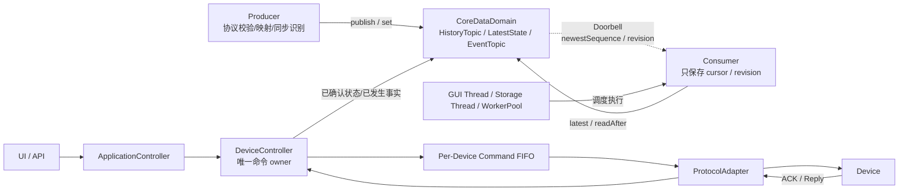

# 仓库编码规则

## 强制架构边界

本仓库后端目标架构采用“共享强类型数据域 + Consumer 游标读取 + 独立 Command 控制平面”。任何新增模块、重构方案和代码审查都必须先阅读：

- `doc/architecture/09-共享强类型数据域与游标读取模型.md`：进程内数据协作的权威规范；
- `PROJECT_CONTEXT.md`：旧系统现状、新仓库启动资料和当前待办。

若旧文档中的 `DataPacket/SystemBus/BusWorker`、每 Consumer 数据队列或万能消息设计与上述规范冲突，以本节和 09 文档为准。`05～08` 中的旧链路只作为迁移、联试和回退证据。

### 固定架构图


固定总览图为 `doc/architecture/新架构3.png`，后续模块划分、箭头方向和职责边界均不得偏离该图；
`doc/architecture/09-共享强类型数据域与游标读取模型.md` 负责补充图片无法承载的读取、内存和并发合同。
旧版架构图已清理；历史材料如需查阅使用 Git 或只读旧仓库，不得作为编码依据。

箭头语义不得颠倒：

- Producer 主动向 Topic 写入；
- Consumer 主动从 Topic 读取；
- 只有 Doorbell 从 Topic 指向 Consumer，且 Doorbell 不携带业务数据；
- Executor 只负责运行 Consumer，不保存 Topic 数据；
- Command 不进入普通 Topic，也不使用共享 CommandQueue 竞争处理。

### 数据平面硬规则

1. `CoreDataDomain` 只包含强类型数据对象：
   - 当前已落地且有真实合同的 `HistoryTopic<TrackPacket>`；
   - 未来只有在真实设备协议和消费场景明确后才允许新增 `HistoryTopic<OpticalPacket>` 等强类型对象；
   - `LatestState<DeviceState/TaskState/SystemState>`；
   - `EventTopic<SystemEvent>`。
2. 数据本体只在 Topic/State 中持久驻留一份；`HistoryTopic<T>` 使用启动期预分配的内嵌槽位，Reader 只能把
   有界批次复制到自身固定、可复用的 `ScratchBuffer`，不得把临时副本演化为第二份长期历史。
3. `HistoryTopic<T>` 负责共享有界 RingBuffer、`publish()`、`latest()`、`readAfter()`、sequence gap 和覆盖统计。
4. `LatestState<T>` 只负责 KeepLast(1)、`set()`、`latest()` 和 revision。
5. `EventTopic<SystemEvent>` 是有界事件日志；Info、Warning、Error、Fault、Alarm 第一版不拆 Topic。
6. 每个 HistoryTopic 有独立 sequence 空间；同一 Reader 读取多个 Topic 时必须为每个 Topic 分别维护 cursor。
7. Topic retention 与 Reader cursor 无关；慢 Reader 不能阻塞 Producer，落后时必须显式处理 gap。
8. 使用 `QMutex` 保护预分配槽位和水位的短临界区；Producer 解锁后才报告 Doorbell，Reader 取得有界副本并
   解锁后才做 GUI、数据库、Web 或插件工作。未经实测不得改成 lock-free。
9. Doorbell 只向 `ExecutionLane` 报告更新提示；每个 Lane 使用原子 pending bitmask 合并突发更新，同一 Lane
   同时最多保留一个待执行 Qt 唤醒，不允许按每条 Sample 累积 queued event。
10. Consumer 只持有 cursor/revision、最终派生状态和固定 `ScratchBuffer`；调度合并状态属于 ExecutionLane，
    禁止每个 Consumer 自建 `scheduled/running/requestedWatermark`、线程、定时轮询或完整消息 Queue。
11. Topic 不保存 Consumer、Executor 或 per-consumer Mailbox，不执行 Consumer 回调，也不创建中央工作线程。

### Command 控制平面硬规则

固定调用链：

```text
UI/API
  -> ApplicationController
  -> DeviceController
  -> Per-Device Command FIFO
  -> ProtocolAdapter
  -> Device
```

- `DeviceController` 是设备命令的唯一 owner；
- 每台设备拥有独立、有界 FIFO，满时必须明确返回 Busy，禁止静默覆盖；
- ACK、超时、失败和设备状态变化先由 owner 处理，再写入 `LatestState<DeviceState>` 或 `EventTopic<SystemEvent>`；
- `CommandResult` 返回原请求者，不把普通 Topic 当 RPC；
- 禁止把 Command FIFO 抽象成跨类型中央消息总线。

### 禁止重新引入

- `DataPacket`、`QVariant`、`std::variant` 万能进程内消息；
- `sourceType + dispatchTarget + command` 业务路由；
- 中央 FIFO Broker、`SystemBus::instance()`、BusWorker；
- `Topic -> Consumer Mailbox -> Consumer`；
- 每 Consumer 完整消息 Queue；
- signal/slot 直接传输完整实时业务数据；
- Topic 内的协议解析、业务状态机、数据库写入、Command dispatch；
- 为了画面完整而提前创建没有真实字段契约的 `PointPacket`、`OpticalPacket`、State 或 Event 空壳类型；
- 引入 `PointEndpoint`、`PointPacket` 或 `PointTopic`；当前上位机只接收雷达航迹，不存在独立点迹数据链；
- 未经实测提前引入 DDS 全套能力、复杂 QoS、lock-free 或跨进程共享内存。

### 复杂度预算与类型收敛

任何新增结构体、类、队列、缓存、DTO、适配层或数据转换阶段都必须证明它解决的是当前真实需求，而不是为
假设中的未来扩展预留位置。代码评审默认拒绝增加链路长度和公开类型数量，除非提交同时说明上游输入、下游
输出、不能复用现有类型的原因、生命周期与删除条件。

- 一条实时数据链原则上保持 `Producer -> Shared Typed Topic <- Consumer`；Doorbell 只增加调度提示，不增加数据层。
- 每类 Producer 只输出一种权威业务事实；协议 DTO 只能是边界内短生命周期临时对象，不得进入 Topic。
- Consumer 只能形成一个面向自身最终职责的派生状态；禁止固化“标准事实 -> 临时视图 -> 中间视图 -> 最终视图”。
- Topic 的 `TopicRecord/HistoryReadResult/SequenceGap` 属于统一读取协议；读取记录只能存在于调用方预分配的
  `ScratchBuffer`，不得包装成新的业务消息或跨轮次积压。
- 没有真实输入字段的可选子结构、没有当前 Consumer 的 Topic、只为图示完整存在的空类型，一律不实现。
- 同一信息不得在多个长期对象中以不同结构重复保存；Reader 短暂读取 Sample 后，只能保留完成最终职责必需的派生状态。
- 新增公开数据结构前必须先更新对应合同；若一个功能需要增加两个以上公开业务结构，必须先与用户讨论复杂度。
- 存储归档可以消费多种强类型 Topic，但每个 Topic 必须使用独立 cursor 和映射器；禁止为统一落库重新引入万能归档包。
- 删除无真实需求的类型和层级优先于用注释解释其“未来可能用途”。

### 简单性、优化与所有权原则

仓库实现遵循以下总原则：

> 先写最简单、正确、所有权明确的实现；只有真实数据证明存在性能问题时，才增加优化复杂度；只有真实需求证明存在第二种实现时，才增加抽象。

- **简单不等于省略契约**：第一版仍须正确处理输入校验、容量边界、失败返回、线程亲和性和资源释放，不得以“先跑起来”为由制造隐式行为。
- **优化必须由测量驱动**：新增缓存、对象池、批处理、原子状态、无锁结构或专用线程前，必须给出可复现的负载、基线数据、目标指标和优化后的对比结果；没有证据时保留更简单的实现。
- **抽象必须由真实变化驱动**：接口、模板、基类、工厂、通用 DTO 或适配层至少应服务于两个已经存在且语义不同的实现或调用场景；仅有一个实现时优先使用具体类型。
- **所有权必须可从接口读出**：每个状态、队列、Socket、线程、定时器和外部副作用都必须有唯一 owner；借用对象的生命周期、线程归属及可空性应在类型或中文 Doxygen 契约中明确，不依赖调用顺序或口头约定。
- **职责必须单一且可删除**：新增层必须能够说明其唯一职责、上游输入、下游输出以及删除条件；只转发参数、不建立边界、不消除重复的薄包装默认不引入。
- **评审顺序固定**：先验证正确性和架构边界，再检查资源占用；不得为尚未出现的吞吐、设备类型或部署方式提前搭建通用框架。

### 实时链路资源预算

- 热路径业务结构必须定长、连续、可预分配；字符串业务标识使用注册表分配的数值句柄，禁止在每条
  `TrackPacket` 中重复保存 `QString`。
- 热路径可选字段使用明确的 validity/flags 表达，不得无评估堆叠 `std::optional`、动态容器或隐式堆对象。
- `HistoryTopic<T>` 在启动时完成固定容量分配；正常 publish/readAfter 不得逐条进行常规堆分配。
- 不使用 `#pragma pack` 牺牲对齐；必须通过字段排序、`sizeof`/`alignof`/字段偏移测试和基准数据收敛布局。
- 一个 ExecutionLane 可以串行运行多个有状态 Consumer；同一 Consumer 不得并发执行，不要求“一 Reader 一线程”。
- GUI/Web 复用已有事件循环；归档启用时最多懒启动一个共享存储 Lane；插件未启用时不得创建插件线程。
- 空闲时不得轮询 Topic；突发 publish 必须被合并为有界唤醒，Producer 永远不等待 Consumer。
- `SampleMeta`、`TrackPacket`、`TrackKey`、RingBuffer 总内存、每次批量上限和运行期分配次数必须有自动化验收。

### 新旧代码隔离

- `core/bus/*`、`DataPacket`、`SystemBus`、`BusWorker` 属于待退出旧实现，不得继续承载新架构功能；
- 旧代码只允许为回归修复、迁移适配和删除依赖而修改，且必须明确标注迁移目的；
- 新共享数据域代码应放在独立 `core/datadomain/`，不得放进旧 `core/bus/` 或持久化 `core/data/`；
- 新仓库建立后不得复制旧 `core/bus/`，需要参考旧实现时只读访问归档仓库；
- 同一外部副作用在迁移期间只能有一个正式执行路径：显示不能双广播、存储不能双写、Command 不能双发。

## 强制使用中文 Doxygen 注释

本仓库所有新增或修改的代码，都必须同步编写和维护中文 Doxygen 注释。

- C++ 的文件职责、类型、数据结构、公开接口和字段契约统一写在 `.h` 头文件中。
- 每个 `.h` 文件必须包含 `@file` 注释，说明文件职责与架构边界。
- 每个 `.cpp` 函数定义前必须具有中文 `/** ... */` Doxygen 注释；不得用一个泛化文件头代替逐函数注释。
- `.cpp` 注释重点说明实现目的、关键步骤、状态变化、失败行为和线程约束；参数与返回值的稳定外部契约以头文件为准，避免复制后产生两份不一致文档。
- 所有公开或受保护的类、结构体、枚举、类型别名、函数、方法、信号和槽必须使用 `/** ... */` 注释。
- 涉及跨线程、跨模块、持久化、输入输出或业务规则的非简单私有方法也必须使用 Doxygen 注释。
- 函数按需使用 `@brief`、`@param`、`@return`、`@throws`、`@note`、`@warning`、`@pre`、`@post` 和线程安全章节。
- 字段使用 `///< ...`；涉及所有权、单位、生命周期、边界或并发时必须明确写出。
- 必须明确坐标系、时间基准、计量单位、所有权、可空性、队列上限、失败行为和线程亲和性。
- TypeScript/TSX 使用兼容 Doxygen 的 JSDoc，说明组件、Hook、参数、返回值和状态所有权。
- 测试注释必须说明验收标准、所防止的回归，以及非显然的夹具和时间假设。
- 注释必须使用中文；类型名、字段名、协议名等不可翻译的技术标识可以保留英文。
- 注释解释契约和设计意图，不复述语法；过期注释按代码缺陷处理。
- 禁止“实现某函数的处理流程”“具体契约见头文件”“该字段保存业务状态”“对应模块的类型与接口”等
  可套用到任意代码的模板句。删除这类注释比保留它更好，但对外接口和非显然实现仍必须补充真实信息。
- 文件注释至少回答：本模块位于哪条链路、上游输入、下游输出、明确不负责什么，以及新人应从哪个入口阅读。
- 函数实现注释应优先解释代码本身看不出的内容：调用前提、步骤顺序的原因、状态变化、回滚/降级策略、
  并发边界和协议/业务约束；能从函数名和代码逐行直接读出的内容不写。
- 对应注释缺失、不准确或仍以英文叙述时，代码任务不得视为完成。

## 提交前检查

1. 检查头文件契约以及每个 `.cpp` 函数定义是否具有中文 Doxygen 注释。
2. 运行仓库注释审计脚本。
3. 新增公开符号缺少注释时，验收直接失败。
4. 搜索并拒绝无项目知识也能生成的模板化注释。
5. 注释修改后必须重新编译并运行测试。
