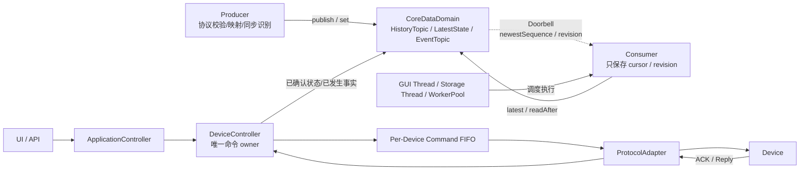

# 仓库编码规则

## 强制架构边界

本仓库后端目标架构采用“共享强类型数据域 + Consumer 游标读取 + 独立 Command 控制平面”。任何新增模块、重构方案和代码审查都必须先阅读：

- `doc/architecture/09-共享强类型数据域与游标读取模型.md`：进程内数据协作的权威规范；
- `PROJECT_CONTEXT.md`：旧系统现状、新仓库启动资料和当前待办。

若旧文档中的 `DataPacket/SystemBus/BusWorker`、每 Consumer 数据队列或万能消息设计与上述规范冲突，以本节和 09 文档为准。`05～08` 中的旧链路只作为迁移、联试和回退证据。

### 固定架构图



箭头语义不得颠倒：

- Producer 主动向 Topic 写入；
- Consumer 主动从 Topic 读取；
- 只有 Doorbell 从 Topic 指向 Consumer，且 Doorbell 不携带业务数据；
- Executor 只负责运行 Consumer，不保存 Topic 数据；
- Command 不进入普通 Topic，也不使用共享 CommandQueue 竞争处理。

### 数据平面硬规则

1. `CoreDataDomain` 只包含强类型数据对象：
   - `HistoryTopic<TrackPacket/PointPacket/OpticalPacket>`；
   - `LatestState<DeviceState/TaskState/SystemState>`；
   - `EventTopic<SystemEvent>`。
2. 数据本体只由 Topic/State 持有一份不可变实例；Reader 只能短暂持有只读句柄。
3. `HistoryTopic<T>` 负责共享有界 RingBuffer、`publish()`、`latest()`、`readAfter()`、sequence gap 和覆盖统计。
4. `LatestState<T>` 只负责 KeepLast(1)、`set()`、`latest()` 和 revision。
5. `EventTopic<SystemEvent>` 是有界事件日志；Info、Warning、Error、Fault、Alarm 第一版不拆 Topic。
6. 每个 HistoryTopic 有独立 sequence 空间；同一 Reader 读取多个 Topic 时必须为每个 Topic 分别维护 cursor。
7. Topic retention 与 Reader cursor 无关；慢 Reader 不能阻塞 Producer，落后时必须显式处理 gap。
8. 第一版使用 `QMutex` 保护短临界区；Producer 解锁后才触发 Doorbell，Reader 解锁后才做 GUI、数据库、Web 或插件工作。
9. Qt signal/slot 只允许传递 `newestSequence/revision` 等 Doorbell 水位，不得传递完整业务对象。
10. Topic 不保存 Consumer、Executor 或 per-consumer Mailbox，不执行 Consumer 回调，也不创建中央工作线程。

### Command 控制平面硬规则

固定调用链：

```text
UI/API
  -> ApplicationController
  -> DeviceController
  -> Per-Device Command FIFO
  -> ProtocolAdapter
  -> Device
```

- `DeviceController` 是设备命令的唯一 owner；
- 每台设备拥有独立、有界 FIFO，满时必须明确返回 Busy，禁止静默覆盖；
- ACK、超时、失败和设备状态变化先由 owner 处理，再写入 `LatestState<DeviceState>` 或 `EventTopic<SystemEvent>`；
- `CommandResult` 返回原请求者，不把普通 Topic 当 RPC；
- 禁止把 Command FIFO 抽象成跨类型中央消息总线。

### 禁止重新引入

- `DataPacket`、`QVariant`、`std::variant` 万能进程内消息；
- `sourceType + dispatchTarget + command` 业务路由；
- 中央 FIFO Broker、`SystemBus::instance()`、BusWorker；
- `Topic -> Consumer Mailbox -> Consumer`；
- 每 Consumer 完整消息 Queue；
- signal/slot 直接传输完整实时业务数据；
- Topic 内的协议解析、业务状态机、数据库写入、Command dispatch；
- 为了画面完整而提前创建没有真实字段契约的 `PointPacket`、`OpticalPacket`、State 或 Event 空壳类型；
- 未经实测提前引入 DDS 全套能力、复杂 QoS、lock-free 或跨进程共享内存。

### 新旧代码隔离

- `core/bus/*`、`DataPacket`、`SystemBus`、`BusWorker` 属于待退出旧实现，不得继续承载新架构功能；
- 旧代码只允许为回归修复、迁移适配和删除依赖而修改，且必须明确标注迁移目的；
- 新共享数据域代码应放在独立 `core/datadomain/`，不得放进旧 `core/bus/` 或持久化 `core/data/`；
- 新仓库建立后不得复制旧 `core/bus/`，需要参考旧实现时只读访问归档仓库；
- 同一外部副作用在迁移期间只能有一个正式执行路径：显示不能双广播、存储不能双写、Command 不能双发。

## 强制使用中文 Doxygen 注释

本仓库所有新增或修改的代码，都必须同步编写和维护中文 Doxygen 注释。

- C++ 的文件职责、类型、数据结构、公开接口和字段契约统一写在 `.h` 头文件中。
- 每个 `.h` 文件必须包含 `@file` 注释，说明文件职责与架构边界。
- 每个 `.cpp` 函数定义前必须具有中文 `/** ... */` Doxygen 注释；不得用一个泛化文件头代替逐函数注释。
- `.cpp` 注释重点说明实现目的、关键步骤、状态变化、失败行为和线程约束；参数与返回值的稳定外部契约以头文件为准，避免复制后产生两份不一致文档。
- 所有公开或受保护的类、结构体、枚举、类型别名、函数、方法、信号和槽必须使用 `/** ... */` 注释。
- 涉及跨线程、跨模块、持久化、输入输出或业务规则的非简单私有方法也必须使用 Doxygen 注释。
- 函数按需使用 `@brief`、`@param`、`@return`、`@throws`、`@note`、`@warning`、`@pre`、`@post` 和线程安全章节。
- 字段使用 `///< ...`；涉及所有权、单位、生命周期、边界或并发时必须明确写出。
- 必须明确坐标系、时间基准、计量单位、所有权、可空性、队列上限、失败行为和线程亲和性。
- TypeScript/TSX 使用兼容 Doxygen 的 JSDoc，说明组件、Hook、参数、返回值和状态所有权。
- 测试注释必须说明验收标准、所防止的回归，以及非显然的夹具和时间假设。
- 注释必须使用中文；类型名、字段名、协议名等不可翻译的技术标识可以保留英文。
- 注释解释契约和设计意图，不复述语法；过期注释按代码缺陷处理。
- 禁止“实现某函数的处理流程”“具体契约见头文件”“该字段保存业务状态”“对应模块的类型与接口”等
  可套用到任意代码的模板句。删除这类注释比保留它更好，但对外接口和非显然实现仍必须补充真实信息。
- 文件注释至少回答：本模块位于哪条链路、上游输入、下游输出、明确不负责什么，以及新人应从哪个入口阅读。
- 函数实现注释应优先解释代码本身看不出的内容：调用前提、步骤顺序的原因、状态变化、回滚/降级策略、
  并发边界和协议/业务约束；能从函数名和代码逐行直接读出的内容不写。
- 对应注释缺失、不准确或仍以英文叙述时，代码任务不得视为完成。

## 提交前检查

1. 检查头文件契约以及每个 `.cpp` 函数定义是否具有中文 Doxygen 注释。
2. 运行仓库注释审计脚本。
3. 新增公开符号缺少注释时，验收直接失败。
4. 搜索并拒绝无项目知识也能生成的模板化注释。
5. 注释修改后必须重新编译并运行测试。
