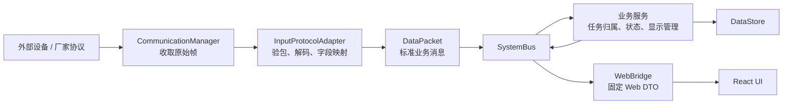
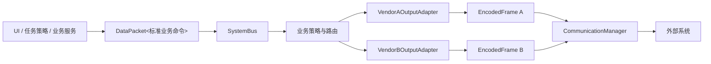

# DataPacket 统一消息与分层边界

## 1. 文档定位

本文定义上位机内部数据流的固定基座，以及厂家协议和差异化业务的扩展边界。

核心结论：

> `DataPacket` 是 core 内部统一消息信封；payload 只能承载标准业务对象。厂家原始报文只存在于通信边界，React UI 只接收固定 Web DTO。

系统允许厂家 A、厂家 B 的协议与业务模块共存，但它们必须通过适配器接入，不能把厂家结构体、字段判断或客户分支扩散到 core。

## 2. 总体链路

### 2.1 上行数据



固定规则：

1. COM 层只知道 endpoint、传输协议和字节流。
2. 协议适配器负责将厂家报文转换为标准业务对象。
3. 进入 SystemBus 后不再出现厂家协议结构体。
4. 业务服务只消费标准 DataPacket，不解析原始字节。
5. UI 不直接理解 C++ DataPacket，由 WebBridge 转换为版本化 Web DTO。

### 2.2 下行数据



标准业务命令可以同时被多个输出适配器订阅，因此厂家 A、B 可以在同一进程中共存，也可以按任务配置只启用其中一个。

## 3. 各层职责与边界

### 3.1 Communication 层

输入输出模型：

```cpp
struct ReceivedFrame {
    QString endpointId;
    qint64 receivedAtMs = 0;
    QByteArray bytes;
};

struct EncodedFrame {
    QString endpointId;
    QString targetName;
    QByteArray bytes;
};
```

职责：

- 管理 UDP/TCP/串口等通信端点；
- 接收和发送字节流；
- 记录端点级错误、时间戳与收发统计。

禁止：

- 解析航迹、设备状态或厂家业务字段；
- 判断任务归属；
- 根据客户名称编写业务分支；
- 直接生成 UI DTO。

### 3.2 Protocol Adapter 层

职责：

- 帧边界、校验和、大小端、协议版本校验；
- 厂家字段与标准业务字段之间的映射；
- 标准业务命令到厂家报文的编码。

典型接口：

```cpp
class IInputProtocolAdapter {
public:
    virtual ~IInputProtocolAdapter() = default;
    virtual DecodeResult decode(const ReceivedFrame& frame) = 0;
};

class IOutputProtocolAdapter {
public:
    virtual ~IOutputProtocolAdapter() = default;
    virtual EncodeResult encode(const BusinessMessage& message) = 0;
};
```

禁止：

- 决定是否追踪、告警、引导光电或转发给某客户；
- 查询 UI 状态；
- 修改任务状态；
- 将厂家结构体直接发布到 SystemBus。

协议适配器回答“这段字节是什么意思”，业务策略回答“这个标准业务事件应该触发什么动作”。

### 3.3 DataPacket 与 SystemBus 层

`DataPacket` 由稳定消息头和类型安全 payload 组成：

```cpp
struct MessageHeader {
    uint32_t messageType = 0;
    uint16_t schemaVersion = 1;

    uint64_t messageId = 0;
    uint64_t correlationId = 0;
    uint64_t timestampMs = 0;

    QString taskId;
    QString sourceDeviceId;
    uint16_t sourceService = 0;
    uint16_t dispatchTarget = 0;
};

template<typename T>
struct DataPacket {
    MessageHeader header;
    std::shared_ptr<const T> payload;
};
```

消息头负责回答：

- 这是什么消息及其 schema 版本；
- 来自哪个业务设备、属于哪个任务；
- 由哪个服务发布、发往哪个业务目标；
- 与哪一次请求或业务链路相关。

payload 负责承载标准业务内容，例如：

```text
TrackBatch
DeviceRuntimeStatus
GuidanceRequest
GuidanceCommand
RadarRuntimeSettings
TrackDisplaySnapshot
TrackInteractionCommand
SystemEvent
```

SystemBus 只负责：

- 发布、订阅与路由；
- 消息队列和线程边界；
- 基础流量、丢包和延迟观测。

SystemBus 不负责：

- 决定任务归属；
- 调用哪一家厂商协议；
- 修改业务状态；
- 解析 payload 内部字段完成业务分支。

### 3.4 Domain / Business 层

每个业务服务应保持短链路：

```text
订阅一种或少量标准消息
  -> 校验自己的业务前置条件
  -> 修改自己拥有的状态
  -> 发布新的标准业务消息或持久化结果
```

示例：

```text
TrackBatch
  -> TaskContextResolver 确认 taskId/deviceId
  -> TrackDisplayManager 生成显示状态
  -> DataPacket<TrackDisplaySnapshot>

TrackSelected
  -> GuidancePolicy 判断设备能力和任务规则
  -> DataPacket<GuidanceRequest>
  -> Vendor A/B OutputAdapter
```

边界原则：

- 一个服务只拥有一类明确业务状态；
- 服务之间不直接读写彼此内部成员；
- 跨服务协作通过标准消息或明确查询接口完成；
- 厂家差异较大时新增 BusinessPolicy，不在通用服务中堆积 `if (vendor == A)`。

### 3.5 DataStore 层

职责：

- 持久化设备台账、任务执行、历史航迹、日志和快照；
- 提供事务和基础查询能力。

禁止：

- 在通用 DataStore 中实现厂家业务规则；
- 由数据库记录反向驱动未定义的隐式状态机；
- 将当前设备元数据直接当作历史任务快照。

任务激活时应固化设备、集成方案和协议版本快照，使历史数据可以按当时语义解释。

### 3.6 Web / UI 层

固定链路：

```text
DataPacket<业务快照>
  -> WebBridge / API Presenter
  -> versioned JSON 或 Protobuf DTO
  -> React
```

UI 可以：

- 展示后端确认的任务、设备、状态和显示数据；
- 提交用户意图；
- 维护纯交互态，例如面板展开、筛选条件。

UI 不可以：

- 自己决定任务归属或生成最终业务 ID；
- 解析厂家协议；
- 成为设备、任务和航迹交互状态的第二事实源；
- 直接依赖 C++ DataPacket 的内存布局。

## 4. Payload 设计决策

### 4.1 当前实现的问题

当前 `DataPacket` 使用固定 `rawData[4096]`、协议联合体和 `memcpy` 打包，小包阶段可用，但不适合作为长期业务消息模型：

- 每个消息固定携带大块内存；
- `GeneralPackage` 等具体协议结构污染通用包；
- 只能安全承载 trivially-copyable 类型；
- 直接序列化 C++ 内存布局缺少跨版本稳定性；
- 大对象被迫另走 `BusEnvelope::shared_ptr<const void>`，形成双轨。

### 4.2 目标方案

目标是保留 DataPacket 的统一信封概念，替换 payload 机制：

1. 小型、固定业务类型可使用 `std::variant`；
2. 航迹批次和显示快照等大对象使用 `shared_ptr<const T>`，只在总线上传递只读引用；
3. raw `QByteArray` 仅用于 Communication 与 Protocol Adapter 的边界；
4. `payloadType + schemaVersion` 必须稳定注册，不能按厂家随意占号；
5. 禁止继续新增 `shared_ptr<const void>` 的无类型 payload。

推荐的标准 payload 集合应保持有限。新增厂家通常只增加适配器，不增加新的 core payload 类型；只有出现新的业务语义时，才扩展标准业务模型。

## 5. 厂家 A/B 共存模型

```text
integration/
  builtin/
    DefaultInputAdapter
    DefaultOutputAdapter
    DefaultBusinessPolicy

  vendor_a/
    VendorAInputAdapter
    VendorAOutputAdapter
    VendorABusinessPolicy
    manifest.json

  vendor_b/
    VendorBInputAdapter
    VendorBOutputAdapter
    VendorBBusinessPolicy
    manifest.json
```

集成包声明：

```json
{
  "id": "vendor_a",
  "version": "1.2.0",
  "inputProtocols": ["radar-a"],
  "outputProtocols": ["guidance-a"],
  "businessPolicies": ["radar-opto-guidance-a"]
}
```

共存规则：

- A/B 模块可以同时编译进产品；
- endpoint 配置决定输入帧交给哪个 adapter；
- 任务或集成方案决定启用哪些 BusinessPolicy 与 OutputAdapter；
- 同一标准消息可以同时输出为 A、B 两种协议；
- 未启用模块不得订阅业务消息或占用通信端点。

第一阶段采用编译期注册、配置启用。接口和版本治理稳定后，再评估 Qt 动态插件，避免过早增加部署与 ABI 复杂度。

## 6. 任务快照关系

任务执行快照不能只保存设备 ID，还应保存：

```text
deviceSnapshot
integrationProfileId
integrationProfileVersion
inputAdapterId / version
outputAdapterIds / versions
businessPolicyIds / versions
runtimeSettingsSnapshot
outputRoutesSnapshot
```

这样厂家协议升级后，历史任务仍能回答“当时使用了哪套设备、协议、参数和业务规则”。

## 7. 迁移路径

### 阶段 1：统一概念

- 将 `DataPacket` 明确为消息头；
- 将当前 `BusEnvelope` 视为过渡实现；
- 冻结新的 `shared_ptr<const void>` 与协议 union 扩展。

### 阶段 2：提取标准业务 payload

- 先迁移 `TrackDisplaySnapshot`、`TrackInteractionCommand`；
- 再迁移 RuntimeSettings、设备状态和工作模式命令；
- 为每种 payload 建立 type id、schema version 和契约测试。

### 阶段 3：协议适配器化

- 将 `RadarDataProcessor` 中协议解析拆为 InputAdapter；
- 将 `DphPublisher/BusToCommRouter` 中具体编码拆为 OutputAdapter；
- 保留现有协议作为 `builtin` 集成方案，确保行为不变。

### 阶段 4：验证扩展性

- 实现一个模拟 Vendor A；
- 不修改 core 业务模型，仅新增 adapter、policy 和配置；
- 验证 Vendor A 与 builtin 同时启用、独立路由和任务快照。

## 8. 架构底线

以下依赖关系固定不变：

```text
Communication -> ProtocolAdapter -> DataPacket -> SystemBus -> Business
Business -> DataPacket -> SystemBus -> OutputAdapter -> Communication
Business -> DataPacket -> WebBridge -> Web DTO -> React
```

出现以下情况即表示边界被破坏：

- core 业务服务 include 厂家协议头文件；
- React 根据厂家名称决定协议字段或业务流程；
- CommunicationManager 根据 payload 业务字段做判断；
- 协议适配器直接修改 TaskService、TrackDisplayManager 内部状态；
- 同一业务对象同时存在 DataPacket、裸 signal、JSON 三套事实源；
- 为厂家 A/B 长期维护不同 core 分支。

基座固定的是标准消息、任务上下文、业务服务与边界；可扩展的是协议适配器、业务策略、输出路由和集成方案。
