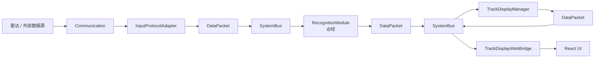
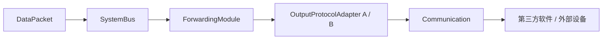

# DataPacket 统一消息与双主链路边界

## 1. 固定结论

本系统接收外部数据后只有两条主业务链路：

1. 将接收到的数据处理后显示在 React UI；
2. 将接收到的数据处理后转换为第三方协议并转发给其他软件或设备。

两条链路共用同一段固定主干：

```text
Communication
  -> InputProtocolAdapter
  -> NormalizedTrackBatch
  -> SystemBus
  -> RecognitionModule
  -> IdentifiedTrackBatch
  -> SystemBus
```

其中，**目标识别是唯一必经的数据处理能力**。显示、对外转发、引导、存储、日志和性能统计都不能成为识别主干上的同步前置条件。

当前尚无真实识别算法时，提供内置 `PassThroughRecognitionModule`：保留航迹数据并把识别结果标记为 `Unknown`。这样主干接口从第一天就是稳定的，未来替换识别算法时不需要修改显示和转发模块。

## 2. 两条主链路

### 2.1 航迹显示



`TrackDisplayManager` 只负责显示缓存、样式和交互状态，不负责协议解析和目标识别。

### 2.2 对外转发



不同厂家通过不同 `OutputProtocolAdapter` 共存。厂家差异不能进入 `IdentifiedTrackBatch`、显示模块或 React。

引导不是第三条系统主链路，而是一种可选的对外输出模块：它订阅已识别航迹和用户交互命令，生成引导命令，再交给相应输出协议适配器。

## 3. 主干与可拆装模块

### 3.1 固定基座

以下部分属于程序基座，不能按厂家复制：

- `CommunicationManager` 和端点管理；
- 输入、输出协议适配器接口；
- `DataPacket` 标准消息头和标准业务 payload；
- `SystemBus`；
- 任务与设备上下文；
- 识别模块接口及内置透传实现；
- 模块注册、配置和生命周期管理；
- 固定 Core-Web DTO 边界。

### 3.2 可拆装处理服务

```text
必经：
  RecognitionModule

可配置启停：
  TrackDisplayModule
  ForwardingModule
  GuidanceModule
  TrackStorageModule
  RuntimeLogModule
  PerformanceMetricsModule

按厂家替换或并存：
  InputProtocolAdapter
  OutputProtocolAdapter
```

“可拆装”首先表示接口隔离、独立注册和配置启停，不等于现阶段立即做 DLL。第一阶段仍编译在同一 core 中；接口稳定后，再使用 Qt Plugin 或稳定 C ABI 转为 DLL。直接跨 DLL 暴露 STL/Qt 容器会受编译器和 Qt ABI 约束，不能在接口未稳定时贸然动态化。

## 4. DataPacket 边界

### 4.1 消息头

目标消息头至少回答：

```cpp
struct MessageHeader {
    uint32_t messageType = 0;
    uint16_t schemaVersion = 1;
    uint64_t messageId = 0;
    uint64_t correlationId = 0;
    uint64_t timestampMs = 0;
    QString taskId;
    QString sourceDeviceId;
    uint16_t sourceService = 0;
};
```

- `messageType + schemaVersion`：消息契约；
- `messageId/correlationId`：链路追踪；
- `taskId/sourceDeviceId`：业务归属；
- `sourceService`：发布者身份。

payload 使用类型安全、只读共享对象：

```cpp
template<typename T>
struct DataPacket {
    MessageHeader header;
    std::shared_ptr<const T> payload;
};
```

一个批次只构造一次，分发给多个订阅者时传递只读引用，不重复深拷贝整批航迹。

### 4.2 标准航迹消息

```text
NormalizedTrackBatch
  输入协议已经解析、坐标和单位已经标准化
  尚未经过目标识别

IdentifiedTrackBatch
  包含标准航迹和识别结果
  是显示、转发、引导和存储共同消费的权威业务消息

TrackDisplaySnapshot
  只包含当前 UI 应显示的数据、样式和交互状态
```

厂家原始报文只允许存在于 `Communication -> InputProtocolAdapter` 边界。进入 `NormalizedTrackBatch` 后，不得再出现 `GeneralPackage` 或厂家字段。

## 5. SystemBus 的准确定位

`SystemBus` 借鉴 DDS 的发布订阅思想，但当前不是完整 DDS。它负责：

- 标准消息发布、订阅和路由；
- 线程边界上的安全传递；
- 模块之间的解耦；
- 基础队列和链路统计。

它不负责：

- 协议解析和目标识别；
- 决定厂家业务规则；
- 执行耗时算法；
- 同步写数据库；
- 因为存在总线就自动获得并行和低时延。

当前 `SystemBus` 只有一个 worker，并按顺序调用命中的订阅回调。目标实现要求订阅回调只做快速校验和投递；识别、转发、存储等耗时工作由模块自己的执行上下文处理，不能占住总线 worker。

第一阶段不实现完整 DDS QoS。先固定以下最小规则：

- 总线队列和模块输入队列必须有界；
- 队列满时必须计数和告警，不能静默无限堆积；
- 显示快照允许新值覆盖旧值；
- 引导命令和对外转发不能静默丢弃；
- 每条主链路必须能测量排队和处理耗时。

## 6. 存储、日志与性能统计

它们是主链路的旁路消费者，不是主链路必经步骤：

```text
IdentifiedTrackBatch ─┬→ 显示
                      ├→ 对外转发
                      ├→ 航迹存储（旁路）
                      └→ 性能统计（旁路）
```

现有存储分工继续保留并明确：

| 数据 | 载体 | 用途 |
| --- | --- | --- |
| 技术日志 | 滚动日志文件 | 开发与现场排障 |
| 任务日志 | `task_logs` | 用户查看某次任务过程 |
| 业务事件 | `system_events` | 任务、设备、控制、异常审计 |
| 航迹历史 | `tracks` | 任务历史航迹 |
| 性能指标 | `pipeline_metrics` | 每 10 秒保存有新样本阶段的 P50/P95/P99 汇总 |

日志和数据库写入必须异步批量执行。性能数据在内存中按时间窗口聚合后写库，不允许每个航迹点同步写一条性能记录。

## 7. 时延定义

主链路记录以下节点：

```text
T0  Communication 收到完整帧
T1  InputProtocolAdapter 完成标准化
T2  RecognitionModule 开始处理
T3  RecognitionModule 发布 IdentifiedTrackBatch
T4  TrackDisplayManager 接收批次
T5  ForwardingModule 完成协议编码
T6  Communication 调用对外发送
```

核心指标：

- `T1-T0`：协议适配耗时；
- `T2-T1`：识别链路排队耗时；
- `T3-T2`：识别处理耗时；
- `T4-T0`：UI 绘制前的后端显示链路耗时；
- `T6-T0`：接收到对外发送的端到端耗时。

进程内耗时使用单调时钟。墙上时间只用于日志时间和跨系统关联。指标至少统计 P50、P95、P99、最大值、样本数、丢弃数和队列高水位。

### 7.1 当前已实现的测量阶段

`GET /api/metrics/latency` 返回微秒级滚动窗口统计：

| stage | 含义 |
| --- | --- |
| `decode` | UDP 完整帧接收后，到协议解码、设备/任务映射完成 |
| `processorTotal` | UDP 完整帧接收后，到 `RadarDataProcessor` 本次处理返回 |
| `ingressToDisplay` | UDP 完整帧接收后，到 `TrackDisplayManager` 完成该航迹缓存处理 |
| `displayProcessing` | 单个可见航迹进入显示缓存和样式状态处理的耗时 |
| `snapshotWait` | 航迹完成显示缓存后，到下一次 snapshot 构建开始的等待时间 |
| `snapshotBuild` | 构建一次全量 `TrackDisplaySnapshot` 的耗时 |
| `snapshotBusDispatch` | 显示快照发布到 SystemBus 后，到 WebBridge 订阅回调收到 |
| `webQueue` | WebBridge 从总线线程投递到 Qt 主线程的排队耗时 |
| `webPrepareAndBroadcast` | Web DTO 组装、JSON 准备和调用 WebSocket broadcast 的耗时 |
| `ingressToWebSend` | 同一 snapshot 中最新航迹从 UDP 接收到 WebSocket broadcast 返回的总时间，包含 snapshot 等待 |
| `activeBackendToWebSend` | `ingressToWebSend` 扣除 `snapshotWait` 后的实际后端处理时间 |

说明：

- 统计明确排除浏览器接收与绘制时间；
- `ingressToWebSend` 是当前最接近“COM 到前端绘制前”的整条后端链路指标；
- `activeBackendToWebSend` 用于排除 1 秒刷新策略后的有效处理时间；
- 当前显示快照每 1 秒生成一次，这段定时等待不计入处理耗时，避免把产品刷新策略误判为后端性能；
- 采集路径只做 O(1) 内存追加，P50/P95/P99 仅在查询统计接口时计算；
- 内存接口实时提供最近 4096 个样本的滚动统计；每 10 秒将有新样本的阶段批量写入 SQLite `pipeline_metrics`；
- `ingressToDisplay` 每次成功落库后还会输出一条 `[Latency]` 汇总日志；
- 指标表保存聚合结果而非逐航迹明细，避免性能观测反过来阻塞处理链路。

示例：

```http
GET /api/metrics/latency
```

```json
{
  "ok": true,
  "unit": "us",
  "windowCapacity": 4096,
  "excludesSnapshotInterval": true,
  "stages": {
    "ingressToDisplay": {
      "sampleCount": 1000,
      "windowSampleCount": 1000,
      "minUs": 20,
      "avgUs": 45,
      "p50Us": 40,
      "p95Us": 80,
      "p99Us": 120,
      "maxUs": 300
    }
  }
}
```

## 8. 当前代码审查结论

当前代码已经具备：

- UDP 通信端点和配置；
- `SystemBus` 发布订阅；
- `TrackPoint`、`TrackDisplaySnapshot` 和 WebSocket 显示；
- 任务、设备、航迹历史、任务日志和系统事件；
- 上下行基础平均/最小/最大时延统计。

与本文目标仍有以下差距：

1. `RadarDataProcessor -> TrackDisplayManager` 当前通过 `trackPointReady` Qt signal 直连，没有经过总线；
2. `RadarDataProcessor` 同时承担协议解析、业务映射、航迹存储和总线发布，职责过多；
3. 当前总线仍发布包含 `GeneralPackage` 和固定 `rawData[4096]` 的旧 `DataPacket`；
4. `BusEnvelope` 使用 `shared_ptr<const void>`，尚未形成统一类型安全 payload；
5. 尚无识别模块接口和内置透传识别器；
6. 尚无真正的第三方航迹转发模块，`BusToCommRouter` 当前主要服务雷达控制命令；
7. `SystemBus` 的订阅回调在单 worker 中串行执行；
8. 日志文件逐条 flush，数据库写入尚未形成统一异步存储通道；
9. 数据架构图和核心流程图仍保留当前直连路径用于代码对照，并已标记为待迁移，不能把它理解为最终设计。

## 9. 实施顺序

按照一条纵向链路逐步替换，不同时重写全系统：

1. 增加统一 trace 信息和当前链路性能基线；
2. 定义 `NormalizedTrackBatch`、`IdentifiedTrackBatch` 和类型安全 `DataPacket<T>`；
3. 实现内置透传识别器，打通“标准化 -> 总线 -> 识别 -> 总线”；
4. 将显示链路迁移为订阅 `IdentifiedTrackBatch`，删除 `trackPointReady` 直连；
5. 将航迹存储移到独立旁路消费者，并实现日志/指标异步批量写入；
6. 实现一个模拟第三方输出适配器，验证“接收 -> 识别 -> 转发”链路；
7. 接口稳定后再评估 DLL 动态装卸。

每一步都必须保持程序可运行，并通过同负载下的时延对比确认没有引入不可接受的 P95/P99 退化。

## 10. 架构底线

```text
厂家字节 -> 输入适配 -> 标准航迹 -> 总线 -> 识别 -> 已识别航迹 -> 总线
                                                               ├-> 显示 -> Web
                                                               └-> 输出适配 -> COM -> 第三方
```

以下情况视为破坏基座：

- 显示或转发模块直接解析厂家报文；
- 未经识别主干的航迹成为 UI 或对外输出的正式业务数据；
- React 根据厂家名称解释协议字段；
- 存储或日志同步阻塞识别、显示或转发链路；
- 总线订阅回调直接执行长耗时算法；
- 为厂家 A/B 复制不同的 core 主干；
- 在模块接口尚未稳定时直接形成跨编译器 DLL ABI 依赖。
