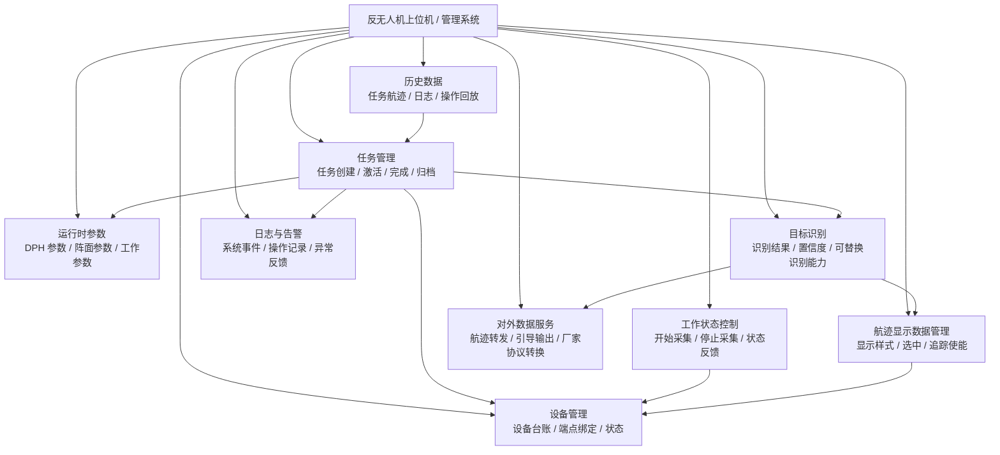
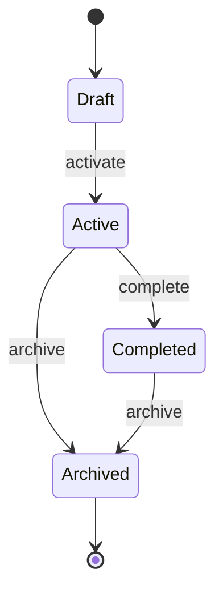

# 01 - 业务架构

> 业务架构只描述系统做什么、管理什么、哪些业务能力彼此协作。  
> 本文不描述 `SystemBus`、`WebService`、数据库表、端口和类名。

## 1. 系统定位

本系统是反无人机雷达上位机 / 管理系统。

核心职责不是替代雷达或数据处理系统做航迹起批、融合、消失判断，而是：

- 管理设备；
- 组织任务；
- 下发控制与运行参数；
- 接收、标准化并识别目标；
- 展示航迹并按第三方协议对外转发；
- 固化日志、告警和历史数据；
- 为 Web UI 和后续第三方提供稳定数据协议。

## 2. 业务能力总览



## 3. 核心业务对象

### Device

业务设备，不等同于通信端点。

负责描述：

- 设备 id、名称、类型；
- 厂家 / 型号；
- 经纬度、高度；
- 雷达阵面参数；
- 与通信端点的绑定关系；
- 当前运行状态。

### Task

任务是管理系统的业务上下文。

负责组织：

- 本任务关联哪些设备；
- 本任务使用哪些运行时参数；
- 本任务期间产生哪些航迹、日志、告警和操作记录；
- 当前任务状态。

任务状态建议：



### Runtime Settings

当前有效运行参数快照。

注意：快照不是为了做网络 diff 优化，而是后端持有的一份“当前有效参数”。

业务规则：

- UI 只在用户调参时提交变化；
- 后端合成完整有效参数；
- 后端按最新参数持续驱动 DPH 发送；
- 没有新参数时继续使用旧参数。

### Track Display

上位机侧不负责航迹起批、消失、融合等数据处理算法。

上位机负责的是航迹显示数据管理：

- 接收已经过识别主干的标准航迹；
- 根据点序号和交互状态决定显示样式；
- 维护选中、高亮、追踪使能等显示状态；
- 给 Web 输出固定显示协议。

### Recognition

目标识别是航迹进入正式业务输出前的唯一必经处理能力。

- 当前没有真实算法时由透传识别器输出 `Unknown`；
- 后续算法可以替换为静态模块或 DLL；
- 显示和对外转发只消费识别后的标准航迹，不直接依赖具体识别算法。

### External Delivery

对外数据服务负责把识别后的标准航迹转换为第三方协议并发送。引导属于可选的对外输出能力，不是独立于显示和转发之外的第三条主业务链路。

## 4. 业务边界

### 上位机负责

- 设备台账；
- 任务上下文；
- 参数快照；
- 工作/待机控制；
- 航迹显示状态；
- 目标识别模块的装配与运行；
- 识别后航迹的对外转发；
- 日志、告警、历史记录；
- 固定 core-web 协议。

### 上位机不负责

- 雷达内部航迹起批；
- 航迹融合算法；
- 目标消失判定算法；
- 厂家私有协议向 Web 透传；
- UI 直接操作外部协议结构体。

## 5. 稳定业务结论

后续实现必须遵守：

```text
设备信息由后端管理
任务是业务上下文
运行时参数由后端合成完整快照
DPH 按最近快照持续发送
航迹对 Web 输出固定显示协议
厂家协议差异只存在于 core 内部
系统只有显示与对外转发两条主业务链路
目标识别是两条链路共用的唯一必经数据处理
显示、引导、转发、存储和日志按模块边界装配
```
