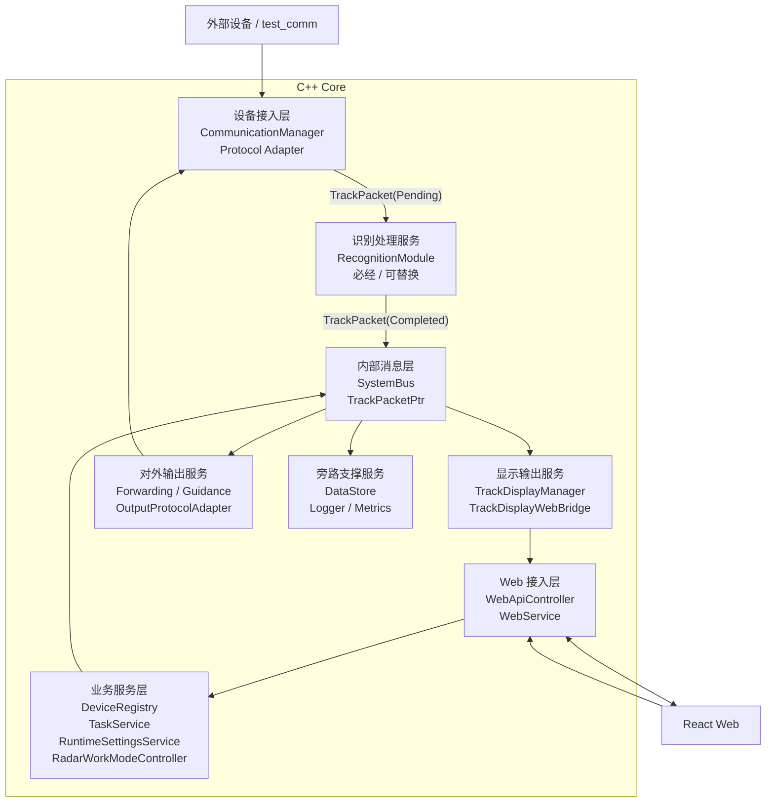

# 02 - 应用架构

> 应用架构描述系统由哪些应用模块组成，以及模块之间如何协作。  
> 它承接业务架构，但比业务架构更接近代码；仍不展开端口、线程、部署细节。

## 1. 应用分层



## 2. 分层职责

### 设备接入层

负责把外部设备协议接进 core。

包含：

- 通信端点管理；
- UDP/TCP 收发；
- 厂家协议结构体；
- 协议适配；
- 原始数据转内部事件。

原则：

- 厂家差异停留在这一层；
- 不向 Web 透出厂家协议；
- 不承载业务状态机。

### 内部消息层

负责 core 内部模块解耦。

包含：

- 类型安全的只读 `TrackPacketPtr` 航迹消息；
- 发布/订阅；
- 线程安全分发。

原则：

- 它是模块协作通道，不负责执行业务算法；
- 标准业务 payload 承载稳定语义，厂家协议结构体不得进入总线；
- 订阅回调只做快速投递，不能同步执行耗时算法或数据库写入。

### 识别处理服务

负责在同一个轻量 `TrackPacket` 中完成识别状态和结果，是显示和对外转发共用的唯一必经处理。

原则：

- 没有真实算法时装配透传识别器并输出 `Unknown`；
- 识别接口与实现分离，第一阶段静态注册，接口稳定后可转 DLL；
- 识别模块不直接调用 Web、数据库或厂家输出协议。

### 业务服务层

负责系统的稳定业务对象。

包含：

- 设备台账；
- 任务服务；
- 运行时参数；
- 工作状态控制；
- 航迹交互、设备、任务、参数和控制等业务状态。

原则：

- 这是后续扩展的主战场；
- UI 和协议都不应该绕过这一层直接互相绑定。

### 显示与对外输出服务

负责识别后航迹的两种正式业务输出，以及设备控制数据的发送。

包含：

- 显示链路：已识别航迹转换为显示快照，经 WebBridge 输出；
- 转发链路：已识别航迹转换为第三方协议，经 Communication 发送；
- 引导：作为可选输出模块生成引导命令；
- DPH 和工作模式控制继续作为设备控制输出。

原则：

- DPH 使用业务层给出的当前参数快照；
- 命令路由使用设备/端点绑定；
- 厂家输出协议只存在于输出适配器；
- 存储、日志和性能统计属于旁路支撑，不阻塞两条主链路。

### 旁路支撑服务

负责航迹历史、任务日志、业务事件和性能指标的异步持久化。它们可以订阅标准消息，但失败或积压不能阻塞识别、显示和对外转发。

### Web 接入层

负责 REST / WebSocket 和固定 core-web 协议。

包含：

- API route 注册；
- WebSocket 推送；
- DTO 转换；
- 固定 Web 协议输出。

原则：

- WebApiController 是表现层 adapter；
- 它不应该直接理解厂家协议；
- 它输出的是稳定 DTO。

## 3. 当前代码映射

```text
设备接入层:
  core/comm/*
  core/protocol/*
  RadarDataProcessor（当前同时承担协议解析和标准化，待拆）

内部消息层:
  core/bus/*

识别处理服务:
  当前未实现；迁移期使用 PassThroughRecognitionModule

业务服务层:
  DeviceRegistry
  TaskService
  RuntimeSettingsService
  RadarWorkModeController

显示输出服务:
  TrackDisplayManager
  TrackDisplayWebBridge

对外航迹转发:
  当前未实现；BusToCommRouter 当前主要用于设备控制命令

设备控制输出:
  DphPublisher
  BusToCommRouter

旁路支撑服务:
  DataStore
  Logger

Web 接入层:
  WebService
  WebApiController

React Web:
  ui/src/*
```

## 4. 应用架构基座

这套应用架构仍然符合 `doc/architecture/系统架构.drawio` 的基本分层；旧 `系统架构.png` 仅是历史导出图，不作为当前设计依据。

```text
外部设备
  -> 通信接入
  -> 数据处理
  -> SystemBus
  -> Web/API/UI

UI/命令
  -> Web/API/业务控制
  -> SystemBus/路由
  -> 通信接入
  -> 外部设备
```

后续新增模块应接入下面两条固定主线，不得绕开标准消息和总线边界：

```text
输入适配 -> 标准航迹 -> SystemBus -> 识别 -> SystemBus -> 显示 -> Web
输入适配 -> 标准航迹 -> SystemBus -> 识别 -> SystemBus -> 输出适配 -> Communication
```

存储、日志和性能统计只作为旁路订阅者。详细边界见 `doc/DataPacket统一消息与分层边界.md`。
