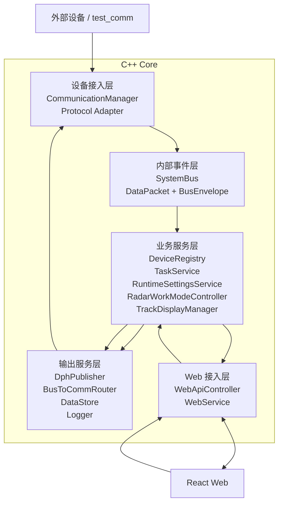

# 02 - 应用架构

> 应用架构描述系统由哪些应用模块组成，以及模块之间如何协作。  
> 它承接业务架构，但比业务架构更接近代码；仍不展开端口、线程、部署细节。

## 1. 应用分层



## 2. 分层职责

### 设备接入层

负责把外部设备协议接进 core。

包含：

- 通信端点管理；
- UDP/TCP 收发；
- 厂家协议结构体；
- 协议适配；
- 原始数据转内部事件。

原则：

- 厂家差异停留在这一层；
- 不向 Web 透出厂家协议；
- 不承载业务状态机。

### 内部事件层

负责 core 内部模块解耦。

包含：

- 内部事件信封（`DataPacket` 路由头 + `BusEnvelope` 大对象载荷）；
- 发布/订阅；
- 线程安全分发。

原则：

- 它是内部事件通道，不是最终业务模型；
- 业务语义由业务服务层解释；
- `DataPacket` 用于小包和固定协议；`BusEnvelope` 用于大对象和 Web/UI 输出 DTO。

### 业务服务层

负责系统的稳定业务对象。

包含：

- 设备台账；
- 任务服务；
- 运行时参数；
- 工作状态控制；
- 航迹显示数据管理。

原则：

- 这是后续扩展的主战场；
- UI 和协议都不应该绕过这一层直接互相绑定。

### 输出服务层

负责向设备、数据库和日志系统输出。

包含：

- DPH 周期发送；
- 反向命令路由；
- 数据库存储；
- 日志与事件记录。

原则：

- DPH 使用业务层给出的当前参数快照；
- 命令路由使用设备/端点绑定；
- 存储层不承载业务规则。

### Web 接入层

负责 REST / WebSocket 和固定 core-web 协议。

包含：

- API route 注册；
- WebSocket 推送；
- DTO 转换；
- 固定 Web 协议输出。

原则：

- WebApiController 是表现层 adapter；
- 它不应该直接理解厂家协议；
- 它输出的是稳定 DTO。

## 3. 当前代码映射

```text
设备接入层:
  core/comm/*
  core/protocol/*
  RadarDataProcessor

内部事件层:
  core/bus/*

业务服务层:
  DeviceRegistry
  TaskService
  RuntimeSettingsService
  RadarWorkModeController
  TrackDisplayManager

输出服务层:
  DphPublisher
  BusToCommRouter
  DataStore
  Logger

Web 接入层:
  WebService
  WebApiController

React Web:
  ui/src/*
```

## 4. 应用架构基座

这套应用架构仍然符合 `doc/系统架构.png` 的基本主线：

```text
外部设备
  -> 通信接入
  -> 数据处理
  -> SystemBus
  -> Web/API/UI

UI/命令
  -> Web/API/业务控制
  -> SystemBus/路由
  -> 通信接入
  -> 外部设备
```

后续新增模块应接入这条主线，不得绕开既有领域服务和总线边界。
