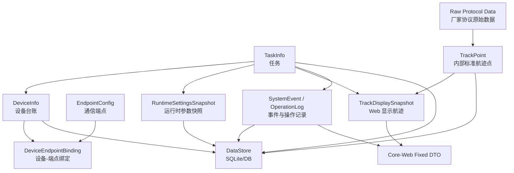

# 03 - 数据架构

> 数据架构描述系统有哪些核心数据、谁拥有它们、如何流转和持久化。  
> 它不关心具体 UI 组件，也不展开类依赖。

## 1. 数据域总览



## 2. 数据所有权

| 数据 | 所有者 | 说明 |
| --- | --- | --- |
| `EndpointConfig` | 通信配置 | 描述如何收发数据 |
| `DeviceInfo` | 后端设备台账 | 描述业务设备 |
| `DeviceEndpointBinding` | 后端设备台账 | 连接业务设备和通信端点 |
| `TaskInfo` | 后端任务服务 | 描述任务生命周期 |
| `RuntimeSettingsSnapshot` | 后端运行时参数服务 | 当前有效运行参数 |
| `Raw Protocol Data` | 协议适配层 | 厂家协议，不出 core |
| `TrackPoint` | core 内部 | 标准航迹点 |
| `TrackDisplaySnapshot` | 航迹显示管理 | 给 Web 的固定显示数据 |
| `SystemEvent` | 日志/事件服务 | 系统事件、告警、错误 |
| `OperationLog` | 任务/事件服务 | 用户操作记录 |

## 3. 设备数据

设备数据分两层：

```text
EndpointConfig:
  id
  protocol
  localAddress
  localPort
  targets

DeviceInfo:
  deviceId
  name
  type
  vendor
  model
  location
  faces
  endpointBinding
```

结论：

- 端点是通信对象；
- 设备是业务对象；
- 不要把所有设备信息塞进 `endpoints.json`。

## 4. 运行时参数数据

```text
RuntimeSettingsSnapshot:
  version
  updatedAt
  updatedBy
  deviceId
  dphParams
  radarFaces
  workModeIntent
```

规则：

- 当前代码要求 UI 提交完整运行时参数 DTO；
- 后端持有当前有效快照；
- DPH 使用当前有效快照组包；
- 需要记录版本和更新时间；
- 局部更新可以作为后续扩展，但不能和当前 API 契约混写。

## 5. 航迹数据

```text
Raw Protocol Data
  -> TrackPoint
  -> TrackDisplaySnapshot
```

`TrackPoint` 建议字段：

```text
trackId
deviceId
timestamp
range
azimuth
elevation
x/y/z
velocity
rawSource
```

`TrackDisplaySnapshot` 建议字段：

```text
trackId
deviceId
taskId
timestamp
position/polar
display: color/size/shape/opacity/trail/highlight
interaction: selected/trackingEnabled
routing: optional flags
```

结论：

- 上位机不负责航迹生命周期算法；
- 上位机负责航迹显示状态；
- Web 只依赖 `TrackDisplaySnapshot`。

## 6. 固定 Core-Web 数据协议

建议固定这些 DTO：

```text
DeviceInfo
DeviceRuntimeState
TaskInfo
RuntimeSettingsSnapshot
TrackDisplaySnapshot
SystemEvent
CommandResult
```

这是后续第三方接入和前后端稳定协作的基础。
