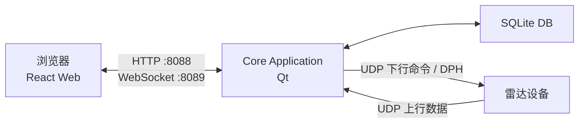
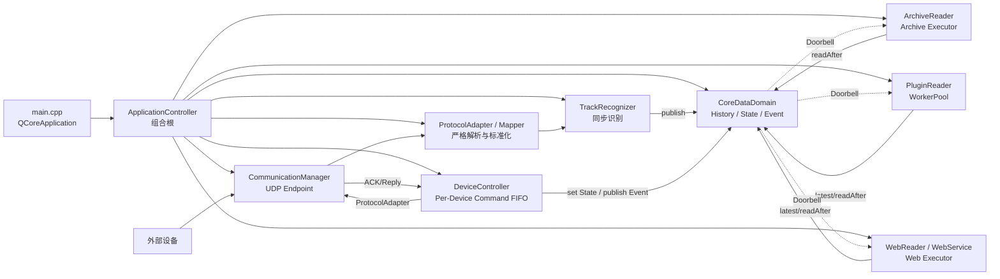

# 04 - 技术架构

> 技术架构描述运行时进程、技术栈、通信协议、端口和部署关系。  
> 它不解释业务规则。
> 2026-08-20 修订：目标进程内协作不再使用中央 `SystemBus/BusWorker`，以 `09-共享强类型数据域与游标读取模型.md` 为准。
> 同名 `.drawio` 尚未同步本次决策，在重新绘制前只以本文 Mermaid 为目标图。

## 1. 技术栈

| 层 | 技术 |
| --- | --- |
| Core | Qt 5.14.2 / C++17 / CMake |
| Web UI | React 19 / TypeScript / Vite |
| 通信 | UDP + HTTP + WebSocket |
| 数据库 | SQLite，后续可扩展 PostgreSQL/MySQL |
| 测试模拟 | 按已冻结设备协议提供的外部报文夹具 |

## 2. 运行时拓扑



## 3. Core 内部技术结构



`CoreDataDomain` 不拥有工作线程，不顺序调用 Display、Storage、Plugin 或 Web。图中的主动读取实线均由 Reader 指向 Domain，反向虚线只表示 Doorbell。

## 4. 线程模型

| 线程 | 职责 |
| --- | --- |
| Qt GUI/主线程 | GUI 状态应用、低频业务控制、定时器；不得执行数据库和重算法 |
| 通信线程 | socket、完整报文边界、轻量协议校验与同步标准化 |
| 归档线程 | ArchiveReader 按 Topic 主动读取、数据库连接、批次事务和提交 |
| Web/socket 所在线程 | WebReader 主动读取、DTO 转换和 socket 发送；第一版可以与主事件循环共享 |
| ExecutionLane | 使用原子 pending bitmask 合并唤醒；插件启用后才创建所需执行资源 |

原则：

- `HistoryTopic/LatestState/EventTopic` 使用 `QMutex` 保护短临界区，不创建线程；
- Producer 在锁内只写槽位、序号和统计，释放锁后再触发 Doorbell；
- Reader 在 ExecutionLane 中调用 `latest()/readAfter()`，把数据复制到固定 ScratchBuffer；解锁后才执行 GUI、数据库、Web 或插件业务；
- Doorbell 只设置 ExecutionLane 的 pending bit；同一 Lane 同时最多保留一个待执行 Qt 唤醒，不按 Sample 累积 queued event；
- 不采用“一类一个线程”或“一个 Reader 一个线程”；GUI/Web 复用事件循环，归档启用时懒启动一个共享存储 Lane；
- Consumer 不保存 `scheduled/running/requestedWatermark`，调度合并状态统一属于 ExecutionLane；
- `ArchiveReader` 在一个存储 Lane 中串行读取 Track/Event，但为每个 Topic 保留独立 committed cursor 与
  ScratchBuffer；`IArchiveRepository` 只提供强类型同步事务入口，返回成功后 Reader 才推进 cursor；
- 不在 Web/UI 层直接访问通信对象，Command 通过 ApplicationController 和 DeviceController 进入控制平面。

## 5. 端口约定

| 端口 | 方向 | 说明 |
| --- | --- | --- |
| 8088 | Browser -> Core | HTTP REST / 静态页面 |
| 8089 | Browser <-> Core | WebSocket |
| 待配置 | Radar -> Core | 雷达上行航迹；由正式协议及设备配置确定 |
| 待配置 | Core -> Radar | 设备命令；由正式协议及设备配置确定 |

端口来自当前配置，后续应继续由配置驱动。

## 6. 技术边界

```text
厂家协议变化:
  新增或替换 input/output adapter / config

识别算法变化:
  替换 RecognitionModule，不修改显示、转发和 Web

Web UI 变化:
  修改 ui 和 core-web DTO adapter

业务规则变化:
  修改业务服务层

部署或端口变化:
  修改 config / 启动参数
```

技术架构目标是让这些变化互相隔离。

## 7. 共享强类型数据域技术约定

目标数据域固定使用：

```text
HistoryTopic<TrackPacket>
HistoryTopic<OpticalPacket>  // 仅在真实光学协议与消费合同形成后增加
LatestState<DeviceState / TaskState / SystemState>
EventTopic<SystemEvent>
```

固定规则：

- 数据对象按稳定业务类型隔离，不使用 `DataPacket/QVariant/std::variant` 万能消息；
- 不使用 `sourceType + dispatchTarget + command` 进行进程内业务路由；
- History/Event 的 sequence 从 1 开始，只在当前 Topic 实例内有效；
- State 使用 revision，不要求 Consumer 处理全部中间修订；
- Topic retention 与 Consumer cursor 无关，容量满时覆盖最老历史；
- cursor 落后时 `readAfter()` 必须返回精确 gap；
- Doorbell 只传 `newestSequence/revision`，不传业务对象；
- Topic 不提供 `pop()`、业务回调订阅、ACK、Command dispatch 或数据库能力；
- Command 只进入独立 `DeviceController -> Per-Device Command FIFO` 控制平面。

当前代码仍使用 `DataPacket/SystemBus`，其真实链路作为迁移基线保留在 `08-现有航迹链路审计与统一入口.md`；它不能继续指导新增模块。最小接口、QMutex 边界和 gap 规则见 `09-共享强类型数据域与游标读取模型.md`。

上位机不存在独立点迹接收链，因此目标架构不包含 `PointEndpoint/PointPacket/PointTopic`。存储模块是跨设备类型的
归档能力：每个已落地强类型 Topic 使用独立 committed cursor 和映射器，共享数据库事务与文件轮转基础设施，
但不得将不同事实重新包装成通用消息。

## 8. 模块与 DLL 边界

当前阶段采用同一进程、编译期注册和配置启停。识别、显示、转发、引导、存储及性能统计按接口隔离，但暂不承诺二进制插件 ABI。

接口稳定后可评估 Qt Plugin 或稳定 C ABI DLL。插件只能获得明确授权的强类型 Topic Reader，维护自己的 cursor 并在 WorkerPool 主动读取；不能访问整个 `CoreDataDomain`、`ApplicationController`、其他模块成员或数据库实现，也不能要求 Topic 为其保留私有队列。
