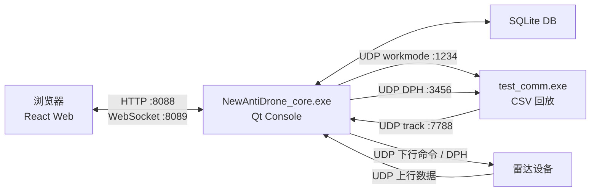
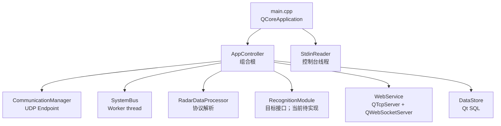

# 04 - 技术架构

> 技术架构描述运行时进程、技术栈、通信协议、端口和部署关系。  
> 它不解释业务规则。

## 1. 技术栈

| 层 | 技术 |
| --- | --- |
| Core | Qt 5.14.2 / C++17 / CMake |
| Web UI | React 19 / TypeScript / Vite |
| 通信 | UDP + HTTP + WebSocket |
| 数据库 | SQLite，后续可扩展 PostgreSQL/MySQL |
| 测试模拟 | test_comm CSV 回放 / UDP |

## 2. 运行时拓扑



## 3. Core 内部技术结构



## 4. 线程模型

| 线程 | 职责 |
| --- | --- |
| Qt 主线程 | QObject、UDP、HTTP、WS、业务服务、定时器 |
| SystemBus worker | 从队列取事件并分发订阅者 |
| StdinReader | 阻塞读取控制台输入 |

原则：

- 业务 QObject 尽量留在主线程；
- 跨线程回调使用 queued connection；
- 不在 Web/UI 层直接访问通信对象。

当前 SystemBus worker 会顺序调用命中的订阅回调，因此总线本身不等于自动并行。目标规则是：总线回调只做快速投递，识别、转发和存储等模块在各自执行上下文中处理；是否增加线程由实测负载决定，不采用“每个类一个线程”。

## 5. 端口约定

| 端口 | 方向 | 说明 |
| --- | --- | --- |
| 8088 | Browser -> Core | HTTP REST / 静态页面 |
| 8089 | Browser <-> Core | WebSocket |
| 7788 | Radar/test_comm -> Core | 雷达上行航迹 |
| 1234 | Core -> Radar/test_comm | workStandby 控制 |
| 3456 | Core -> Radar/test_comm | DPH |

端口来自当前配置，后续应继续由配置驱动。

## 6. 技术边界

```text
厂家协议变化:
  新增或替换 input/output adapter / config

识别算法变化:
  替换 RecognitionModule，不修改显示、转发和 Web

Web UI 变化:
  修改 ui 和 core-web DTO adapter

业务规则变化:
  修改业务服务层

部署或端口变化:
  修改 config / 启动参数
```

技术架构目标是让这些变化互相隔离。

## 7. SystemBus 载荷使用约定

当前 SystemBus 同时支持两种过渡订阅回调：

| 回调类型 | 签名 | 适用场景 |
| --- | --- | --- |
| `BusCallback` | `void(const DataPacket*)` | 小型控制包、固定协议包、通信下行包 |
| `BusEnvelopeCallback` | `void(const BusEnvelope&)` | 大对象、显示 DTO、任务状态、告警批量、历史回放 |

使用规则：

- **存量小型控制包**：迁移期间允许继续使用旧 `DataPacket` + `BusCallback`。
- **存量显示快照和交互命令**：迁移期间继续使用 `BusEnvelope`。
- **新增航迹业务消息**：不得扩展 `rawData` 或 `shared_ptr<const void>`，应直接使用类型安全 `DataPacket<T>`。
- **厂家协议结构体**：不得作为标准总线 payload。

迁移目标是用类型安全 `DataPacket<T>` 统一两条路径，并逐步淘汰固定 `rawData[4096]` 和无类型对象载荷。详细定义见 `doc/DataPacket统一消息与分层边界.md`。

## 8. 模块与 DLL 边界

当前阶段采用同一进程、编译期注册和配置启停。识别、显示、转发、引导、存储及性能统计按接口隔离，但暂不承诺二进制插件 ABI。

接口稳定后可评估 Qt Plugin 或稳定 C ABI DLL。插件必须只依赖版本化标准消息和生命周期接口，不能直接访问 `AppController`、其他模块成员或厂家无关的数据库实现。
