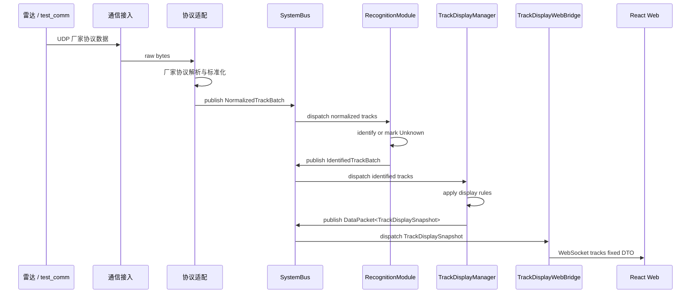
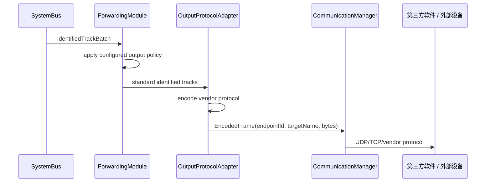
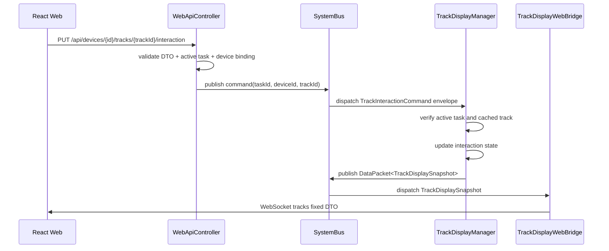
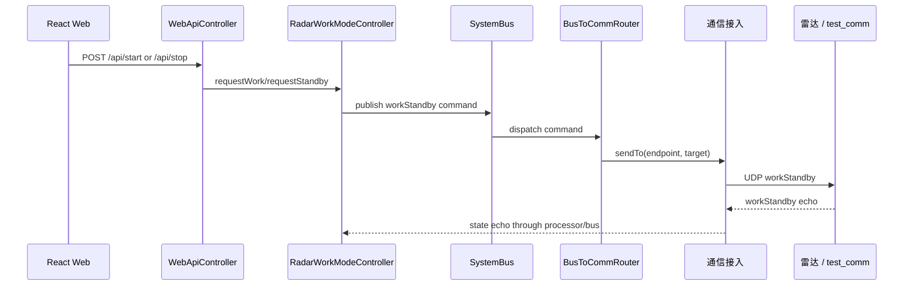
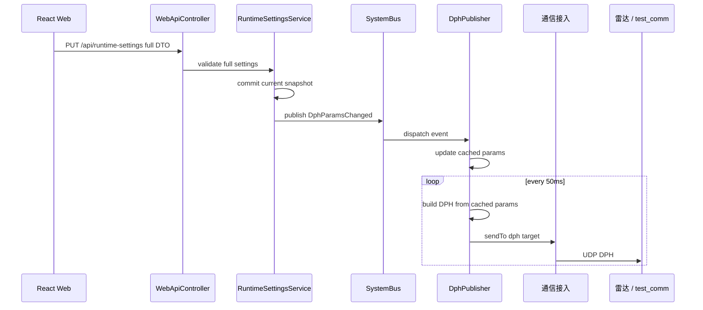
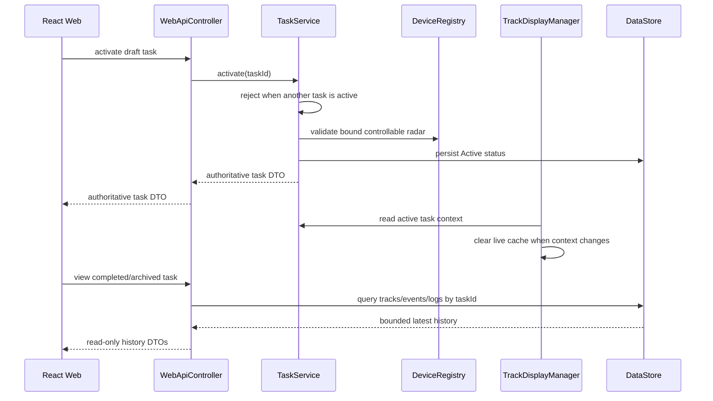
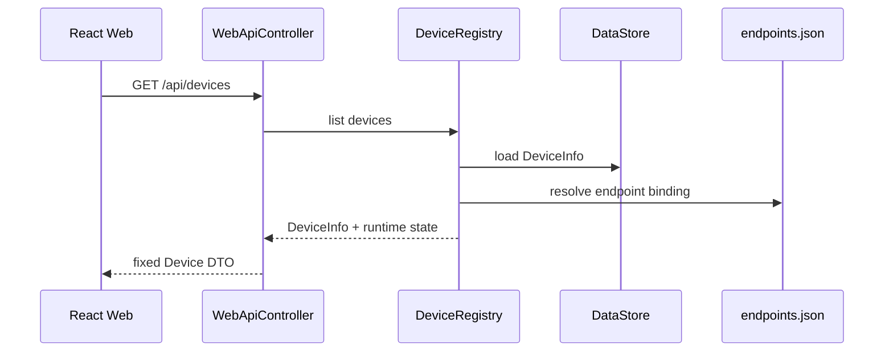

# 05 - 核心流程

> 核心流程描述系统最重要的数据和控制路径。  
> 这些流程应长期稳定，局部模块可以替换，但主路径不应随意改变。

## 1. 上行航迹显示流程

关键原则：

- Web 不接收厂家协议；
- 上位机不做航迹起批、消失和融合算法；
- 识别是标准航迹进入显示和对外转发前的唯一必经处理；
- 没有真实识别算法时由透传识别器输出 `Unknown`；
- 标准航迹和识别结果必须经过 `SystemBus`，不得使用 Processor 到 Manager 的业务旁路；
- 总线订阅回调不能同步执行长耗时算法或数据库写入；
- UI 接收的是显示快照（固定 DTO）；
- `TrackDisplayManager -> Web/UI` 必须经过 `SystemBus + TrackDisplayWebBridge`，不直接打 `WebApiController`。

## 2. 对外航迹转发流程

关键原则：

- 转发只消费识别后的标准航迹；
- 第三方协议差异只存在于 `OutputProtocolAdapter`；
- 显示、存储和日志不能成为转发前置条件；
- 引导属于可选的输出模块，可结合已识别航迹和交互命令生成引导协议；
- 当前代码尚未实现此航迹转发链路，`BusToCommRouter` 主要承担设备控制命令下行。

## 3. 航迹交互命令流程

关键原则：

- `WebApiController` 只校验请求并发布命令，不直接调用 `TrackDisplayManager`；
- 命令必须携带发布时的活动 `taskId`；Manager 仅接受与当前任务一致且仍在缓存中的航迹，防止延迟命令串入下一次任务；
- 航迹交互状态由 `TrackDisplayManager` 持有，经 snapshot 回推给 UI；
- UI 读显示数据与写交互命令均经 `SystemBus` 治理；
- REST 返回 `ok/accepted` 表示命令已成功发布到总线（`mode: queued`），不代表 interaction 已应用；最终显示状态以 WebSocket snapshot 为准。

## 4. 下行工作状态控制流程

关键原则：

- 工作状态由后端状态机管理；
- UI 不直接拼 workStandby 协议包；
- 状态反馈最终同步给 Web。

## 5. DPH 参数更新与周期发送流程

关键原则：

- 当前代码要求 UI 提交完整 `RuntimeSettings` DTO；
- 后端持有完整有效快照；
- DPH publisher 不轮询总线；
- 50ms 周期只负责按最近参数发送。
- 局部参数更新属于后续扩展，不能在图中画成当前契约。

## 6. 任务激活与历史视图流程

固定行为：

- 同一时刻最多一个活动任务；新任务不得静默完成旧任务，结束任务必须显式调用 `complete`；
- 活动任务由后端持久化，core/UI 重启后恢复，不要求用户每次重新创建；
- 任务绑定设备后，航迹、事件和日志按 `taskId + deviceId` 自动归属，不再逐类手工绑定；
- 查看历史记录不改变活动任务，历史航迹和日志只读；
- UI 地图、PPI、表格按当前活动任务或当前历史视图过滤。

## 7. 设备台账加载流程

关键原则：

- 前端加载后端设备台账；
- 通信端点仍由配置驱动；
- 设备和端点通过 binding 关联。
