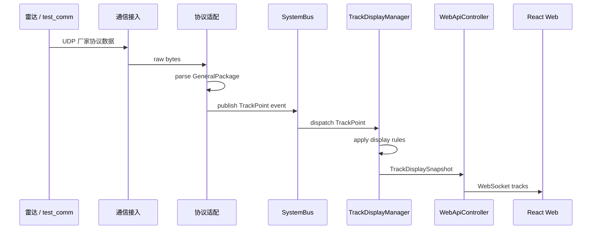
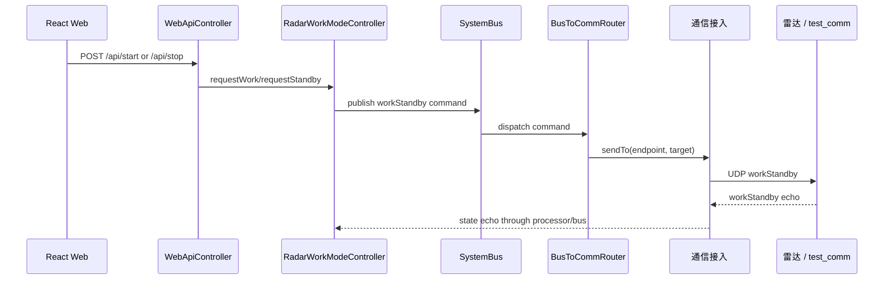
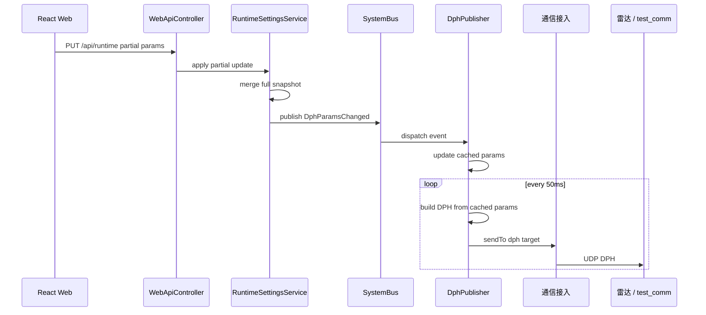
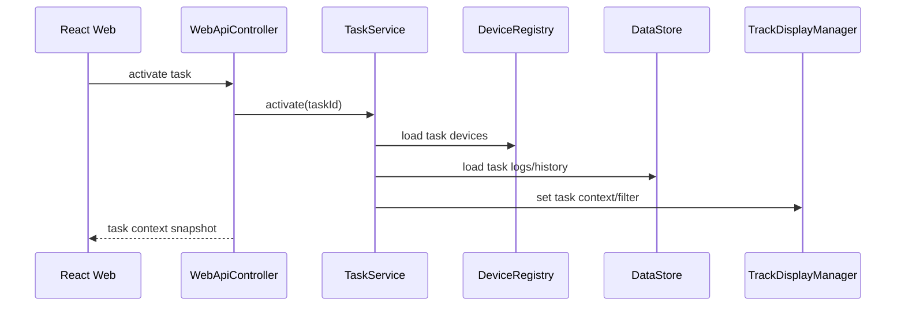
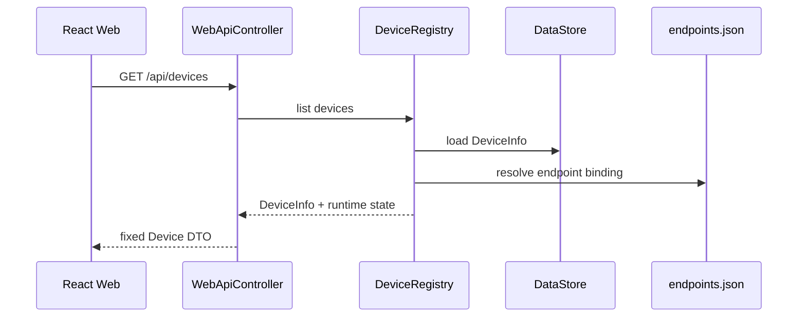

# 05 - 核心流程

> 核心流程描述系统最重要的数据和控制路径。  
> 这些流程应长期稳定，局部模块可以替换，但主路径不应随意改变。

## 1. 上行航迹显示流程

关键原则：

- Web 不接收厂家协议；
- 上位机不做航迹起批/消失算法；
- UI 接收的是显示快照。

## 2. 下行工作状态控制流程

关键原则：

- 工作状态由后端状态机管理；
- UI 不直接拼 workStandby 协议包；
- 状态反馈最终同步给 Web。

## 3. DPH 参数更新与周期发送流程

关键原则：

- UI 只在参数变化时提交；
- 后端持有完整有效快照；
- DPH publisher 不轮询总线；
- 50ms 周期只负责按最近参数发送。

## 4. 任务切换流程

固定行为：

- 切换任务时加载关联设备；
- 切换任务时加载历史航迹；
- 切换任务时加载日志/操作记录；
- UI 地图、PPI、表格跟随任务上下文过滤。

## 5. 设备台账加载流程

关键原则：

- 前端加载后端设备台账；
- 通信端点仍由配置驱动；
- 设备和端点通过 binding 关联。
