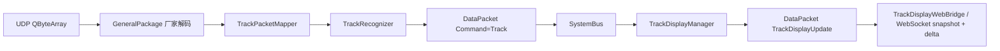
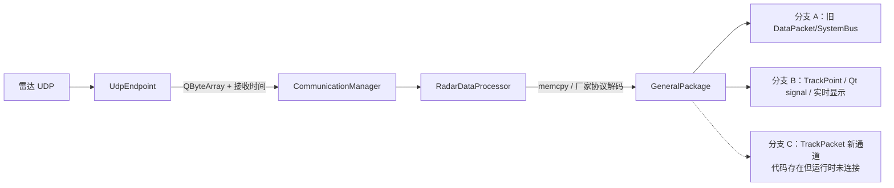
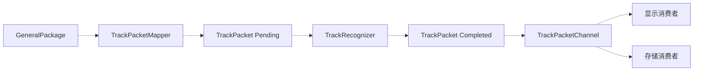
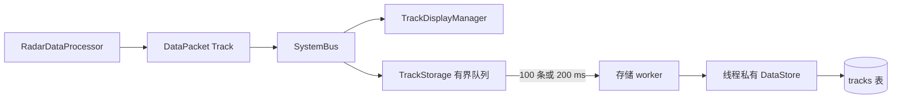
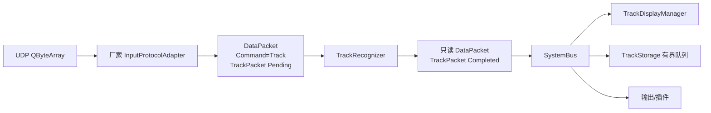

# 08 - 现有航迹链路审计与统一入口

> 审计日期：2026-08-13。  
> 本文回答“为什么看起来存在三条航迹链路”，并记录统一 `DataPacket` 改造前后的真实状态。  
> 迁移状态：2026-08-13 已接通 `DataPacket{Track} -> SystemBus -> TrackDisplayManager`，以下第 3～5 节保留切换前审计证据。

## 1. 先说结论

当前运行时已经收敛为一条航迹显示入口：



已经删除运行时的 `GeneralPackage` 总线发布、`TrackPoint`、`trackPointReady` 直连和独立 `TrackPacketChannel`。现在只有 SystemBus 承载标准航迹。

切换前的审计结论如下：

严格来说，当前不是三条都在运行的完整航迹链路，而是：

1. 一条仍在发布厂家 `GeneralPackage` 的旧总线分支；
2. 一条真正承担实时显示的 `TrackPoint + Qt signal` 直连分支；
3. 一套已经写好并通过单元测试、但未接入运行时的 `TrackPacketChannel` 候选实现。

因此更准确的说法是“两条运行时分支 + 一套未装配的新实现”。三者并存说明迁移停在中途，不代表架构有意设计了三条主链路。

它们共享同一个接收和厂家解码入口：



## 2. 公共接收与解码入口

| 顺序  | 文件                                      | 模块输入          | 模块输出                                         | 说明                                      |
| --- | --------------------------------------- | ------------- | -------------------------------------------- | --------------------------------------- |
| 1   | `core/comm/UdpEndpoint.cpp`             | UDP 数据报       | `QByteArray`、`receivedMs`、`receivedSteadyNs` | `QByteArray` 是 Qt 接收缓冲，不是核心业务结构         |
| 2   | `core/comm/CommunicationManager.cpp`    | Endpoint 接收信号 | `endpointId + QByteArray + 时间`               | 补充端点上下文并转发给输入处理器                        |
| 3   | `core/processor/RadarDataProcessor.cpp` | 端点、字节、时间      | 局部 `GeneralPackage` 或 `workStandby`          | 当前按数据报大小判断协议，再 `memcpy` 到厂家 wire struct |

这里没有必要新增正式 `RawFrame`。正常数据在 `RadarDataProcessor::onCommDataReceived()` 中已经立即按协议解码。只有未来启用原始报文存档时，才应把 `QByteArray` 复制给独立记录器。

## 3. 分支 A：旧 GeneralPackage 总线分支

### 3.1 文件和输入输出

| 模块/文件                                      | 输入                     | 输出                                          |
| ------------------------------------------ | ---------------------- | ------------------------------------------- |
| `RadarDataProcessor::handleGeneralPackage` | `GeneralPackage`、端点和时间 | 旧 `DataPacket`，载荷为完整 `GeneralPackage`       |
| `core/bus/GenericPackets.h`（改造前）           | 厂家结构体                  | `payloadType + payloadSize + rawData[4096]` |
| `core/bus/SystemBus.cpp`                   | `DataPacket`           | 按 `sourceType/dispatchTarget` 分发            |

### 3.2 实际流程


这条分支确实发布到总线，但当前实时显示不消费它。它主要是旧重构阶段遗留的“先把完整厂家包发上总线”方案，不能算一条完整可用的航迹显示链路。

统一改造完成后，`GeneralPackage` 总线命令值及固定 `MAX_PAYLOAD_SIZE` 已删除；厂家结构只存在于 UDP 解码边界。

## 4. 分支 B：当前真正运行的显示链路

### 4.1 文件和输入输出

| 模块/文件                                              | 输入                                 | 输出                                 |
| -------------------------------------------------- | ---------------------------------- | ---------------------------------- |
| `core/processor/RadarDataProcessor.cpp`            | `GeneralPackage`                   | `TrackPoint`                       |
| `core/processor/RadarDataProcessor.h`              | `TrackPoint`                       | Qt signal `trackPointReady`        |
| `core/AppController.cpp::wireTrackDisplayPipeline` | Processor signal                   | 直连 `TrackDisplayManager::addPoint` |
| `core/business/TrackDisplayManager.cpp`            | `TrackPoint`                       | 缓存后的 `TrackDisplaySnapshot`        |
| `core/bus/SystemBus.cpp`                           | `DataPacket{TrackDisplaySnapshot}` | 发布给 WebBridge                      |
| `core/web/TrackDisplayWebBridge.cpp`               | `TrackDisplaySnapshot`             | WebSocket JSON `tracks/snapshot`   |
| `ui/src/hooks/useCoreApi.tsx`                      | WebSocket JSON                     | 前端航迹状态                             |
| `ui/src/components/map/TrackLayer.tsx`             | 前端航迹状态                             | 地图 Canvas 绘制                       |

### 4.2 实际流程


这是当前页面能够显示航迹的真实链路。问题在于前半段绕过了 SystemBus：

```text
RadarDataProcessor::trackPointReady
    -> TrackDisplayManager::addPoint
```

因此只要删除这条 Qt 连接，当前显示就会立即中断。在新的标准航迹总线消费者接通并通过回归测试以前，不能直接删除。

## 5. 分支 C：未接入运行时的 TrackPacket 候选链路

### 5.1 文件和输入输出

| 模块/文件                                  | 输入                                          | 输出                         | 当前使用位置 |
| -------------------------------------- | ------------------------------------------- | -------------------------- | ------ |
| `core/processor/TrackPacketMapper.cpp` | `GeneralPackage + TrackPacketSourceContext` | `TrackPacket(Pending)`     | 单元测试   |
| `core/processor/TrackRecognizer.cpp`   | `TrackPacket(Pending)`                      | 同一对象变为 `Completed/Unknown` | 单元测试   |
| `core/bus/TrackPacketChannel.cpp`      | `shared_ptr<const TrackPacket>`             | 向订阅者分发同一只读指针               | 单元测试   |

### 5.2 代码所表达的候选流程



虚线表示这条路径没有在 `AppController` 中装配：

- `RadarDataProcessor` 没有调用 `TrackPacketMapper`；
- 没有运行时 `TrackPacketChannel` 实例；
- `TrackDisplayManager` 没有订阅它；
- 存储迁移前由 `RadarDataProcessor` 直接执行；现已切换到独立消费者。

因此这不是第三条正在工作的链路，而是尚未完成切换的重构零件。

## 6. 当前存储分支

存储不是另一条解析链路，而是标准航迹发布后的可隔离消费端：



| 文件                          | 输入                              | 输出               | 隔离边界                            |
| --------------------------- | ------------------------------- | ---------------- | ------------------------------- |
| `TrackStorage` 总线回调         | `shared_ptr<const TrackPacket>` | 非阻塞入队            | 不操作 QObject/SQLite；队列满只丢归档副本并计数 |
| `TrackStorage::storageLoop` | 有界队列                            | `QVariantMap` 批次 | 数据库连接只在存储线程创建、使用和销毁             |
| `DataStore::insertBatch`    | 最多 100 条记录                      | `tracks` 事务      | 慢写、锁等待和写失败不会反压显示链路              |

只有 `taskId` 非空的活动任务航迹进入归档队列，保持迁移前的归档规则。默认容量为
4096 条；过载时记录 `queueFullDrops` 和高水位，内存不会无限增长。停机时先取消订阅，
再排空已经接受的记录，最后在线程内关闭数据库连接。

## 7. 本次 DataPacket 重写后的统一入口

本次已将总线消息收敛为：

```cpp
struct DataPacket {
    static constexpr uint32_t Magic = 0x5A5A6B6B;
    static constexpr uint16_t SchemaVersion = 1;

    uint16_t sourceType;
    uint16_t dispatchTarget;
    uint32_t packetSequence;
    uint64_t timeStamp;
    uint64_t traceId;
    DataCommand command;
    DataPayload payload; // std::variant
};
```

保持不变：

- `DeviceType`、`UIWidget`、`ErrorType`、`ErrorLevel`；
- 原有命令数字；
- `sourceType/dispatchTarget/packetSequence/timeStamp`；
- `processor.json` 中现有 `payloadType` 数字配置，迁移期仍按相同数值解释。

已经删除：

- `DataPacket::rawData[4096]`；
- `payloadSize`；
- 手工对内部 `DataPacket` 做 `memcpy` 序列化；
- `BusEnvelope`；
- `shared_ptr<const void>`；
- SystemBus 的 Envelope 第二套发布/订阅接口。

复杂载荷使用 `std::shared_ptr<const T>` 作为 variant 的明确分支；固定厂家协议结构在迁移期可作为值分支。命令字和实际载荷类型会同时校验，不再只依赖调用方约定。

## 8. 已接通的唯一目标链路



迁移进度：

1. [完成] 厂家解码后直接生成 `DataPacket{Track}`；
2. [完成] 发布前运行同步最小识别器；
3. [完成] `TrackDisplayManager` 订阅 `Command::Track`；
4. [完成] 删除 `trackPointReady` 和 `TrackPoint`；
5. [完成] 停止向 SystemBus 发布 `GeneralPackage`；
6. [完成] 存储迁移为独立订阅者并删除 Processor 内直接存储；
7. [完成] 删除独立 `TrackPacketChannel`，统一由 SystemBus 承载。

完成后，航迹从厂家协议边界出来直到各业务消费者，只有一种顶层消息：`DataPacket`。
