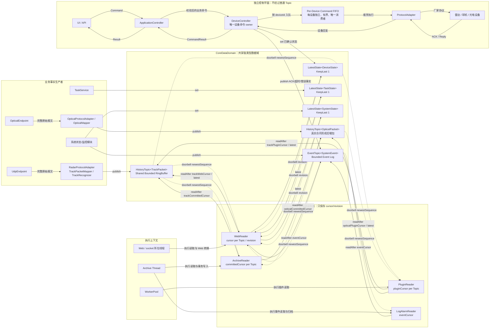

# 09 - 共享强类型数据域与游标读取模型

> 状态：2026-08-20 确认的目标架构，作为进程内数据协作模型的权威规范。
> 当前代码中的 `DataPacket/SystemBus/BusWorker` 仅属于迁移前实现，不再代表目标架构。
> 本文不设计 DDS、复杂 QoS、lock-free、跨进程共享内存或持久消息中间件。

## 1. 架构决定

进程内业务事实统一保存在 `CoreDataDomain` 的强类型数据对象中：

```text
CoreDataDomain
├─ HistoryTopic<TrackPacket>
├─ HistoryTopic<OpticalPacket>
├─ LatestState<DeviceState>
├─ LatestState<TaskState>
├─ LatestState<SystemState>
└─ EventTopic<SystemEvent>
```

当前仓库已经存在 `TrackPacket`。上位机不存在独立点迹输入，因此架构中不设置 `PointPacket/PointTopic`。
`OpticalPacket`、三类 State 和统一 `SystemEvent` 仍是待真实协议或业务合同形成后的目标类型名，不能为了让图完整而创建空壳结构体。

固定关系为：

```text
Producer
    |
    | publish
    v
Shared Typed Topic
    ^
    | latest() / readAfter(cursor)
Consumer

Shared Typed Topic -. doorbell(newestSequence/revision) .-> Consumer
```

不得重新演化为：

```text
Producer -> CentralQueue<DataPacket> -> BusWorker -> Consumer callback
Producer -> Topic -> Consumer Mailbox -> Consumer
```

必须遵守以下约束：

1. Producer 只构造业务事实并调用 `publish()` 或 `set()`。
2. Topic 保存一份共享、不可变的数据本体；Consumer 不通过 `pop()` 取得所有权。
3. Topic 负责容量、覆盖、内部序号和短临界区，不负责执行业务 Consumer。
4. Consumer 只维护 cursor、revision、当前投影状态和 Doorbell 调度标记，不维护完整消息队列。
5. Consumer 的读取进度不参与 retention 计算，也不能阻塞 Producer。
6. Doorbell 只是“数据可能更新”的提示，不携带业务数据，不提供逐条送达保证。
7. Command 使用独立控制平面，不进入 HistoryTopic、LatestState 或 EventTopic 竞争处理。

## 2. 修订后的完整架构图

下图纠正了 `新架构.png` 中的四处问题：

- `UdpEndpoint/OpticalEndpoint` 只负责接收，真正 publish 业务事实的是协议校验、映射和必要识别完成后的 Producer；
- 增加 Consumer 主动读回 Topic 的实线箭头；箭头必须从 Consumer 指向 Topic；
- Executor 是 Consumer 的执行上下文，因此由 Executor 调度 Consumer，而不是 Topic 调用 Consumer；
- Command FIFO 位于 `DeviceController` 按设备完成校验和选路之后，不在 `DeviceController` 之前形成共享命令总线。



图中的实线读取箭头表示函数调用。虚线 Doorbell 箭头只表示唤醒提示，不能被解释为数据传输通道。

## 3. 五个角色的职责

| 角色          | 负责                                                                         | 明确不负责                                         |
| ----------- | -------------------------------------------------------------------------- | --------------------------------------------- |
| Producer    | 完成协议解码、同步映射或业务状态计算；构造不可变事实；调用 `publish()/set()`                            | 不枚举 Consumer，不等待 Consumer，不决定数据保留时间           |
| Topic/State | 保存共享数据；分配 `topicSequence/revision`；执行容量覆盖；检测 cursor gap；暴露读接口和指标           | 不执行业务回调，不持有 Consumer cursor，不按 Consumer 顺序分发  |
| Doorbell    | 告知“最新序号或修订号可能已变化”；允许重复、延迟和合并                                               | 不携带 `TrackPacket` 等业务数据，不保证一条记录一次通知，不保存历史     |
| Consumer    | 在自己的执行上下文中调用 `latest()/readAfter()`；维护 cursor/revision；处理 gap；完成显示、存储或插件业务 | 不从 Topic `pop()`，不影响 retention，不阻塞 Producer   |
| Executor    | 决定 Consumer 在 GUI、存储线程、Web 线程或 WorkerPool 中何时运行                            | 不拥有 Topic 数据，不参与序号和 retention，不成为中央 BusWorker |

Executor 与 Consumer 仍然存在，但二者只决定“在哪里读取和处理”，不再形成 `Mailbox<T>` 数据所有权层。
多个 Reader 可以共享一个 Executor，例如 ArchiveReader 和 LogAlarmReader 可以共用归档线程；架构不要求“一 Reader 一线程”。

每个 HistoryTopic 都有独立的 sequence 空间，因此同一个 Reader 读取 Track、Optical 等不同事实时必须分别维护
`trackCursor`、`opticalCursor`；一个 cursor 不能跨 Topic 复用。存储归档可以复用事务、数据库连接和文件轮转
基础设施，但每种强类型事实必须保留自己的 cursor 与映射器，禁止合并成通用归档消息。

## 4. 三种共享数据语义

### 4.1 HistoryTopic<T>

`HistoryTopic<T>` 是有界、非破坏式读取的 append-only 历史窗口：

- 每次 `publish()` 分配一个 Topic 内部序号；
- 当前有效范围为 `[oldestSequence, newestSequence]`；
- 容量满时覆盖最老槽位，Consumer cursor 不影响覆盖；
- `latest()` 返回最新一条记录；
- `readAfter(lastSequence, scratchBuffer)` 把仍在窗口内的连续记录复制到 Reader 固定缓冲区；
- `lastSequence + 1 < oldestSequence` 时必须返回明确的 `SequenceGap`；
- `lastSequence > newestSequence` 时返回 `CursorRelation::Ahead`，防止旧进程 cursor 造成永久空读；
- Topic 重建后旧 cursor 失效；第一版 cursor 只在进程内有效。

`readAfter()` 的最小判定规则为：

```text
Topic 为空且 cursor == 0       -> Continuous，返回空
Topic 为空且 cursor > 0        -> Ahead，返回空
cursor > newestSequence        -> Ahead，返回空
cursor + 1 < oldestSequence    -> Gap，报告缺口并从 oldestSequence 返回
其他情况                       -> Continuous，从 cursor + 1 返回
```

Reader 接入时应先连接 Doorbell，再主动读取一次当前 Topic；不能等待“下一声 Doorbell”才初始化。需要从现在开始的 Reader 把 cursor 初始化为 `range().newest`，需要处理现存窗口的 Reader 从 `range().oldest - 1` 开始。

必须区分两类序号：

| 序号               | 所有者                          | 用途                             |
| ---------------- | ---------------------------- | ------------------------------ |
| `sourceSequence` | 设备或 Producer，位于 `SampleMeta` | 检测设备、UDP 或协议入口缺口               |
| `topicSequence`  | `HistoryTopic<T>`            | RingBuffer 定位和 Consumer cursor |

`topicSequence` 不提供跨 Topic、跨进程或跨设备的全局业务顺序。

### 4.2 LatestState<T>

`LatestState<T>` 只保留一个完整状态：

- `set()` 原子替换当前不可变状态并递增 revision；
- `latest()` 返回值与对应 revision；
- 新 revision 可以覆盖未被 Consumer 读取的旧 revision；
- Device、Task、System 状态应由各自唯一 owner 写入；
- 中间状态转换若需要审计，另行发布 `SystemEvent`。

多设备状态第一版优先使用完整聚合快照，例如 `DeviceState` 内含所有设备当前状态。不要为了按 key 保留历史而提前实现 DDS keyed history。

### 4.3 EventTopic<T>

`EventTopic<SystemEvent>` 使用有界事件日志：

- Info、Warning、Error、Fault、Alarm 第一版统一进入同一 Topic；
- 每个事件不可变且不与后续事件合并；
- Consumer 使用 cursor 顺序读取；
- 事件被覆盖时返回 gap，不能假装日志连续；
- 最后一条 Event 不代表当前 State；
- 法规或审计要求绝对不丢时，应增加持久 journal/WAL，不能依赖无限内存。

## 5. Web 与 Storage 的读取规则

### 5.1 WebReader

`latest()` 只返回 Topic 的最后一条记录。只有当 `T` 本身是完整快照时，才能用它代表完整显示状态。

当前 `TrackPacket` 表示单条航迹观测，不是全量航迹快照。因此唯一 Web 显示出口应维护轻量 `webCursor` 和当前显示投影：

```text
Doorbell 或 Web 服务启动/连接补偿时机
  -> readAfter(webCursor, webScratchBuffer)
  -> 将 TrackPacket 折叠为 upsert/remove 显示状态
  -> 处理成功后推进 webCursor
```

若发生 gap，WebReader 可以优先实时性清理并从当前驻留窗口重建 snapshot，但不能阻塞 Producer 补历史。

### 5.2 ArchiveReader

ArchiveReader 可以归档航迹、光学、状态和事件等不同强类型事实，但不能把它们包装为通用数据包。对于每个
HistoryTopic，必须分别保存一个 committed cursor；该 cursor 表示“该 Topic 最后成功提交到数据库的序号”：

```text
readAfter(committedCursor, archiveScratchBuffer)
  -> 检查 gap
  -> 开启数据库事务
  -> 写入批次
  -> commit 成功
  -> committedCursor = batch.lastSequence
```

读取成功但数据库提交失败时不得推进对应 Topic 的 cursor。数据库停顿期间 Producer 继续写入 Topic；若停顿
超过某一历史窗口，ArchiveReader 必须只对该 Topic 记录 gap 并发布归档降级事件，不能连带推进其他 Topic。

当前第一版已落地为 `core/archive/ArchiveReader`：Track 与 Event 共用一个存储 Lane slot，但分别持有
`m_trackCommittedCursor/m_eventCommittedCursor`、固定 ScratchBuffer、gap 和提交失败计数。同步事务边界是
`core/archive/IArchiveRepository` 的两个强类型批量方法；方法返回 true 才代表整批已提交。当前 Reader 先
提供 gap/失败指标，待存储服务的事件限频策略确定后再发布归档降级 `SystemEvent`，避免 EventTopic 自消费
形成错误风暴。

因此，共享 RingBuffer 能保证实时链路不被存储阻塞，但不能同时承诺“任意长数据库故障期间绝不丢数据”。后者需要后续 WAL。

### 5.3 PluginReader、WebReader 与 LogAlarmReader

- PluginReader 为每个需要读取的 HistoryTopic 保存独立 cursor；插件积压只影响自己。
- WebReader 按输出协议选择 `latest()` 或 `readAfter()`，WebSocket snapshot/delta 状态仍由 Web 层负责。
- LogAlarmReader 只从 `EventTopic<SystemEvent>` 顺序读取，告警当前态若有需要应另建 `LatestState<ActiveAlarmState>`，第一版不新增 ErrorTopic。

## 6. 最小 Qt/C++ 接口

模板类不能直接可靠地使用 Qt `Q_OBJECT`/moc 信号。因此 Topic 使用普通 C++ 模板保存数据，Doorbell 由非模板 `TopicDoorbell` 提供。

以下代码用于汇总接口语义；HistoryTopic、EventTopic、ScratchBuffer 与 ExecutionLane 已落地到 `core/`，
LatestState 仍待真实 State 合同形成后继续收敛：

```cpp
/**
 * @file SharedDataDomainInterfaces.h
 * @brief 定义共享强类型数据域的有界历史、最新状态、事件日志和轻量 Doorbell 接口。
 * @details 本示例只描述进程内共享读取契约，不包含协议解析、业务路由、Command、数据库或跨进程传输。
 */

#pragma once

#include <QObject>
#include <QMutex>
#include <QtGlobal>

#include <atomic>
#include <memory>
#include <optional>
#include <vector>

namespace core::domain {

/** @brief HistoryTopic 和 EventTopic 内部使用的单调位置序号。 */
using TopicSequence = quint64;

/** @brief LatestState 每次成功替换完整状态时递增的修订号。 */
using StateRevision = quint64;

/**
 * @brief 非模板 Qt Doorbell，只通知某个共享数据对象的最新版本可能已变化。
 * @details 信号不携带业务数据，允许重复、延迟或合并；Consumer 必须回到 Topic/State 主动读取。
 */
class TopicDoorbell final : public QObject
{
    Q_OBJECT

public:
    /** @brief 创建 Doorbell；parent 只控制 Qt 对象生命周期。 */
    explicit TopicDoorbell(QObject* parent = nullptr);

    /**
     * @brief 从任意 Producer 线程报告共享数据对象已经推进到指定版本。
     * @param newestVersion 已完成写入的最新 sequence 或 revision。
     * @note 本函数只更新原子水位并安排一次合并通知，不读取或缓存业务数据。
     */
    void ring(quint64 newestVersion) noexcept;

Q_SIGNALS:
    /**
     * @brief 通知观察者共享数据对象可能已经更新。
     * @param newestVersion History/Event 传 newestSequence，LatestState 传 revision。
     */
    void advanced(quint64 newestVersion);

private:
    /** @brief 在 Doorbell 所在线程发出合并后的最新水位提示。 */
    void flush();

    std::atomic<quint64> m_newestVersion {0};   ///< 已报告但不一定已经通知的最大版本。
    std::atomic_bool m_flushScheduled {false}; ///< 是否已有一次 flush 等待事件循环执行。
};

/** @brief Topic 当前仍可读取的闭区间；空 Topic 使用 empty=true。 */
struct TopicRange
{
    TopicSequence oldest = 0;  ///< 当前仍可读取的最老序号。
    TopicSequence newest = 0;  ///< 当前仍可读取的最新序号。
    bool empty = true;         ///< true 表示尚未发布任何记录。
};

/** @brief Consumer 因落后于历史窗口而无法再读取的连续序号区间。 */
struct SequenceGap
{
    TopicSequence firstLost = 0;  ///< 第一条已被覆盖的期望记录。
    TopicSequence lastLost = 0;   ///< 最后一条已被覆盖的期望记录。
};

/** @brief Consumer cursor 与 Topic 当前保留窗口之间的关系。 */
enum class CursorRelation : quint8
{
    Continuous,  ///< cursor 之后的数据仍连续可读，或者 Consumer 已经追上。
    Gap,         ///< cursor 之后的一部分记录已经被 RingBuffer 覆盖。
    Ahead        ///< cursor 来自旧 Topic/旧进程，已经大于当前 newestSequence。
};

/** @brief 带公共来源、时间和质量元数据的强类型业务事实；完整定义由数据模型层提供。 */
template<typename T>
struct Sample;

/** @brief HistoryTopic 槽位和 Reader ScratchBuffer 共用的定长记录。 */
template<typename T>
struct TopicRecord
{
    TopicSequence sequence = 0;  ///< Topic append 时分配的位置序号。
    Sample<T> sample;            ///< Topic 内嵌原件或 Reader 有界短期副本。
};

/** @brief Reader 构造一次并跨读取轮次复用的固定容量连续缓冲区。 */
template<typename T>
class TopicScratchBuffer;

/** @brief readAfter 返回的有界批次、缺口和读取时水位。 */
template<typename T>
struct HistoryReadResult
{
    qsizetype count = 0;                  ///< ScratchBuffer 前 count 项有效。
    CursorRelation relation = CursorRelation::Continuous; ///< cursor 与当前窗口的关系。
    std::optional<SequenceGap> gap;       ///< cursor 已落后时给出的明确缺口。
    TopicSequence newestAtRead = 0;       ///< 取得短锁时观察到的最新序号。
    bool hasMore = false;                 ///< 受 ScratchBuffer 容量限制后是否仍有记录可读。
};

/** @brief HistoryTopic/EventTopic 的容量、水位和覆盖统计。 */
struct TopicStats
{
    qsizetype capacity = 0;          ///< 固定槽位容量。
    qsizetype size = 0;              ///< 当前有效记录数。
    quint64 slotStorageBytes = 0;    ///< 预分配记录槽位的内存预算。
    quint64 overwrittenRecords = 0;  ///< 因容量满而被覆盖的累计记录数。
    TopicRange range;                ///< 当前有效序号范围。
};

/**
 * @brief 保存单一业务类型有界历史的共享 RingBuffer。
 * @details 所有方法只在短临界区内持有 QMutex；Consumer 业务处理必须发生在函数返回后。
 */
template<typename T>
class HistoryTopic final
{
public:
    /**
     * @brief 创建固定容量的历史 Topic。
     * @param capacity 最多保留的记录数，必须大于零。
     */
    explicit HistoryTopic(qsizetype capacity);

    /**
     * @brief 追加不可变 Sample，必要时覆盖最老槽位。
     * @return 本次追加得到的 Topic 内部序号。
     */
    TopicSequence publish(Sample<T> sample);

    /** @brief 把当前最新记录复制到 output；Topic 为空时返回 false。 */
    bool latest(TopicRecord<T>& output) const;

    /**
     * @brief 非破坏式读取 lastSequence 之后仍在历史窗口内的记录。
     * @param lastSequence Consumer 已成功处理的最后序号；Topic 不会修改该 cursor。
     * @param output Reader 构造期定容并跨轮次复用的 ScratchBuffer。
     * @return 有界批次、可能存在的 gap 和本次读取水位。
     */
    HistoryReadResult<T> readAfter(
        TopicSequence lastSequence,
        TopicScratchBuffer<T>& output) const;

    /** @brief 返回当前有效历史范围。 */
    TopicRange range() const;

    /** @brief 返回容量、当前水位和累计覆盖统计。 */
    TopicStats stats() const;

    /** @brief 返回只负责更新提示的 Qt Doorbell；不得通过它传输 T。 */
    const TopicDoorbell* doorbell() const noexcept;
};

/** @brief LatestState 保存的不可变完整状态及其修订号。 */
template<typename T>
struct StateRecord
{
    StateRevision revision = 0;  ///< 本次完整状态的单调修订号。
    SamplePtr<T> sample;         ///< 当前不可变完整状态。
};

/** @brief 只保存一个最新完整状态的强类型共享对象。 */
template<typename T>
class LatestState final
{
public:
    /** @brief 创建尚未设置初始值的 LatestState。 */
    LatestState();

    /** @brief 原子替换完整状态并返回新的 revision。 */
    StateRevision set(Sample<T> sample);

    /** @brief 返回当前状态及 revision；尚未设置时返回 std::nullopt。 */
    std::optional<StateRecord<T>> latest() const;

    /** @brief 返回当前 revision；尚未设置时为零。 */
    StateRevision revision() const;

    /** @brief 返回只负责状态更新提示的 Qt Doorbell。 */
    const TopicDoorbell* doorbell() const noexcept;
};

/**
 * @brief 保存不可合并业务事件的有界日志。
 * @details 存储机制可复用 HistoryTopic，但接口不暴露 latest()，避免把最后一条事件误当当前状态。
 */
template<typename T>
class EventTopic final
{
public:
    /** @brief 创建固定容量的事件日志。 */
    explicit EventTopic(qsizetype capacity);

    /** @brief 追加不可变事件并返回 Topic 内部序号。 */
    TopicSequence publish(Sample<T> event);

    /** @brief 非破坏式读取 cursor 之后仍可取得的事件。 */
    HistoryReadResult<T> readAfter(
        TopicSequence lastSequence,
        TopicScratchBuffer<T>& output) const;

    /** @brief 返回当前可读取的事件序号范围。 */
    TopicRange range() const;

    /** @brief 返回事件容量、水位和覆盖统计。 */
    TopicStats stats() const;

    /** @brief 返回只负责事件更新提示的 Qt Doorbell。 */
    const TopicDoorbell* doorbell() const noexcept;
};

}
```

真正实现时三个模板都采用 `QMutex` 保护内部槽位、序号和统计：

1. `HistoryTopic` 构造时一次性分配全部内嵌记录槽位，运行期容量不改变；
2. `publish()` 在锁内覆盖一个槽位并更新序号和水位，释放锁后调用 `Doorbell::ring()`；
3. `readAfter()/latest()` 在锁内把有界定长记录复制到调用方对象或固定 ScratchBuffer；
4. Consumer 的 GUI、数据库、Web 和插件处理全部在锁外执行；
5. 第一版不实现 lock-free，也不允许 Consumer 在回调中长期持锁。

## 7. Doorbell 规则

Qt 默认 queued signal 不会自动合并。`TopicDoorbell::ring()` 先通过原子最大水位把 Producer 的连续更新合并为
`advanced(newestVersion)`；后续由共享 `ExecutionLane` 使用 pending bitmask 合并多个 Reader 的运行请求，同一
Lane 同时最多保留一个 Qt 唤醒。Consumer 不自行保存 `scheduled/running/requestedWatermark`：

```text
收到 Doorbell
  -> ExecutionLane 设置对应 Consumer pending bit
  -> 若 Lane 尚无唤醒，则向其 Executor 安排一次运行

Lane 运行
  -> 取走 pending bitmask
  -> 串行运行对应 Consumer 的有界批次
  -> 处理期间再次置位时，合并到下一轮
```

pending bitmask 不保存业务数据，不是 Mailbox，也不改变 Topic retention。空闲时禁止用固定定时器轮询 Topic；
首次接入或显式恢复时可以主动读取范围，以补偿 best-effort Doorbell。

## 8. 数据驻留与 ScratchBuffer 边界

“数据只保存一份”指 CoreDataDomain 只有一份长期历史。RingBuffer 槽位内嵌 `Sample<T>`；读取时只把当前
有界批次复制到 Reader 自己构造期分配的 `TopicScratchBuffer<T>`。

Topic 覆盖与 Reader 生命周期互不依赖：

- ScratchBuffer 容量就是单次读取硬上限，构造后不得扩容；
- ScratchBuffer 只在 Consumer 处理当前轮次时有效，不得跨轮次形成第二份历史；
- Consumer 只能长期保存完成最终职责所必需的派生状态；归档长期数据由数据库事务承担；
- Topic 槽位与 ScratchBuffer 都在启动或 Consumer 创建阶段一次性分配，正常 publish/readAfter 不逐条分配。

## 9. Command 控制平面

Command 不提供 `Topic<DeviceCommand>`，也不通过 Doorbell 竞争处理。固定链路为：

```text
UI/API
  -> ApplicationController
  -> DeviceController（唯一 owner、校验状态和设备）
  -> Per-Device Command FIFO（每设备独立、有界）
  -> ProtocolAdapter
  -> Device
```

反馈链路为：

```text
Device ACK/Reply
  -> ProtocolAdapter
  -> DeviceController
     |-> CommandResult 返回原请求者
     |-> LatestState<DeviceState>.set(已确认状态)
     `-> EventTopic<SystemEvent>.publish(ACK/超时/错误/状态变化事实)
```

Command FIFO 是控制平面中唯一允许的完整命令队列。它按 `deviceId` 隔离、满时明确返回 Busy、命令不得静默覆盖；它不能被抽象成跨类型中央消息总线。

## 10. 第一版明确不做

- 不实现每 Consumer 数据 Mailbox；
- 不实现基于最慢 cursor 的动态 retention；
- 不实现可靠投递、ACK 或 Consumer Group；
- 不实现多级优先级和复杂 QoS profile；
- 不实现内容过滤、通配订阅和字符串 Topic 查找；
- 不实现跨进程共享内存、远程发现和网络复制；
- 不实现 lock-free RingBuffer；
- 不在 Topic 内做协议解析、业务路由、状态机、数据库或 Command dispatch；
- 不新增 `ErrorTopic`，错误、故障和告警统一使用带 severity 的 `SystemEvent`；
- `SystemEvent` 的四类错误域、时间、稳定事件码、控制结果边界和归档语义以
  `../contracts/SystemEvent错误模型契约.md` 为准。

第一阶段只验证四件事：有界覆盖、`latest()`、`readAfter()` 的连续读取与 gap、Doorbell 不携带业务数据。完成这些契约测试后，再迁移现有 `TrackPacket` 显示链路。
