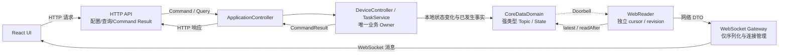

# DCMP 前后端接口契约（V1 实现基线）

> 状态：V1 实现基线。本文只定义 DCMP Core 与 React UI 之间的网络边界，不修改 DP/SP 设备协议，也不改变进程内共享强类型数据域。

## 1. 目的与架构边界

前端通过 HTTP 提交低频查询与操作意图，通过 WebSocket 接收实时事实。后端仍以业务 Owner 和 `CoreDataDomain` 为唯一真源：



必须遵守以下边界：

- HTTP/JSON/WebSocket DTO 只存在于网络序列化边界，不进入 `CoreDataDomain`。
- WebSocket Gateway 不是进程内总线，不保存 Topic 历史、不解释设备协议、不执行业务状态机。
- WebSocket Gateway 不拥有 `DeviceState`、不修改 `TaskState`、不判断 DP/SP 超时、不伪造业务事实，也不直接发送设备 Command。
- WebReader 对每个 `HistoryTopic` 使用独立 cursor，对每个 `LatestState` 使用独立 revision。
- WebSocket 合并网络连接不等于合并 Topic；`TrackPacket`、`DeviceState`、`TaskState`、`SystemState` 和 `SystemEvent` 仍是独立强类型事实。
- Command 只能通过 HTTP 进入 `ApplicationController`，再沿正式控制平面到唯一 Owner；禁止发布到普通 Topic。
- 第一版不实现动态订阅、复杂权限系统、GraphQL、跨进程共享内存和可靠消息中间件。

## 2. 服务地址与版本

| 用途         | 默认地址                           | 说明                         |
| ---------- | ------------------------------ | -------------------------- |
| HTTP API   | `http://127.0.0.1:8088/api/v1` | 配置、查询、历史数据及 Command/Result |
| WebSocket  | `ws://127.0.0.1:8089/ws/v1`    | State、Event 和实时航迹的唯一浏览器出口  |
| React 开发服务 | `http://127.0.0.1:5173`        | 仅开发期使用，由 Vite 代理以上两个入口     |

监听地址和端口允许由部署配置覆盖，但 URL 路径与 V1 字段合同不得随现场配置变化。正式部署优先由同一反向代理提供同源 `/api/v1` 与 `/ws/v1`。

当前 `DeviceState` 与航迹已共用 `ws://127.0.0.1:8089/ws/v1`；`8090` 临时心跳出口已经删除，禁止恢复第二条状态链。

V1 默认只运行在本机 loopback 或受控可信内网。若经反向代理暴露到非可信网络，TLS、身份认证和来源限制由部署层负责；V1 应用协议不重复实现 OAuth、JWT 或 RBAC。

## 3. 公共数据约定

### 3.1 编码与命名

- HTTP 请求体、响应体和 WebSocket 文本帧均使用 UTF-8 JSON。
- 字段使用 `lowerCamelCase`；URL 资源使用小写复数名词。
- `Content-Type` 为 `application/json; charset=utf-8`。
- 未知字段允许接收方忽略；缺少必填字段、字段类型错误或枚举越界必须拒绝。
- V1 不使用 `null` 表示数值缺失；可选字段不存在时直接省略。

### 3.2 标识、时间和序号

| 字段类别                                      | JSON 类型 | 约定                                          |
| ----------------------------------------- | ------- | ------------------------------------------- |
| `deviceId`、`taskId`                       | string  | SQLite/注册表解析出的跨重启稳定 UUID，不暴露进程内 `CompactId` |
| `acquisitionId`                           | string  | 跨重启稳定的采集会话标识，不直接暴露进程内 `AcquisitionId` 数值    |
| `requestId`                               | string  | Command 幂等键和结果关联标识                          |
| `revision`、`expectedRevision`             | string  | 十进制无符号整数，避免 JavaScript 64 位精度损失             |
| `sequence`、`firstSequence`、`lastSequence` | string  | 十进制无符号整数，只在所属事件流内解释                         |
| `firstMissing`、`lastMissing`              | string  | 十进制无符号整数，表示同一流内缺失的闭区间                       |
| `*UtcMs`                                  | number  | Unix epoch UTC 毫秒；只用于展示、查询和审计               |
| 角度                                        | number  | 字段名必须带 `Rad` 或 `Deg` 后缀                     |
| 长度、速度                                     | number  | 字段名必须带 `M` 或 `Mps` 后缀                       |

所有可能增长的 revision 和 sequence 均使用十进制 string；普通业务小整数、mask、`trackId` 和 `pointIndex` 仍使用 number。

revision 不是全局 revision，只允许在同一个逻辑实时流内比较。`SystemState revision`、`DeviceState revision`、`TaskState revision` 和 `Track Web Projection revision` 彼此独立，不具有大小或连续关系。例如 `deviceState revision="900"`、`trackDelta revision="37"` 和 `taskState revision="12"` 可以同时成立。

Topic sequence 和 State/Projection revision 只在当前后端进程生命周期内有效。浏览器断线重连后必须用服务端初始快照完整替换本地状态，不得使用上一进程或上一次连接的 revision/sequence 推断完整性。

### 3.3 Command requestId 幂等规则

`requestId` 同时是 Command Idempotency Key 和 Correlation ID，在单个 DCMP 后端进程内全局唯一，适用于任务启动、停止及后续所有设备 Command：

1. 相同 `requestId` 只能对应一份完全相同的 Command 请求；Command 类型、目标任务、目标设备和业务参数共同构成请求语义。
2. 相同 `requestId` 已产生最终 `CommandResult` 时，重复请求直接返回原结果，不再次向设备下发命令。
3. 相同 `requestId` 仍在执行时，重复 HTTP 请求关联原执行并等待同一个最终结果，不创建第二条设备 Command。
4. 同一 `requestId` 被用于不同 Command 类型或不同目标时返回 409，稳定错误码为 `COMMAND_REQUEST_ID_CONFLICT`。
5. V1 由 `ApplicationController` 与 Command Owner 在单 DCMP 进程内保存执行中请求及最近完成结果；最终结果至少保留 10 分钟，以覆盖浏览器超时和 HTTP 重试。进程重启后不承诺恢复上一进程的内存幂等记录。

该规则不引入分布式幂等服务；调用方在没有收到响应时应使用原 `requestId` 重试，不能为同一操作生成新值。

### 3.4 HTTP 成功与失败格式

成功响应：

```json
{
  "ok": true,
  "data": {}
}
```

失败响应：

```json
{
  "ok": false,
  "error": {
    "code": "DEVICE_CONFIG_CONFLICT",
    "message": "设备配置已被其他操作更新",
    "requestId": "018f..."
  }
}
```

`message` 用于当前 UI 展示，业务判断只能使用稳定 `code`。普通 Query/CRUD 使用以下 HTTP 状态语义；Command 接口的确定映射见 4.3 节：

| HTTP 状态 | 含义                                                               |
| ------- | ---------------------------------------------------------------- |
| 200     | 查询、修改或 Command 已得到最终结果                                           |
| 201     | 资源创建并持久化成功                                                       |
| 400     | JSON 非法、类型错误、必填字段缺失、基础字段范围错误或枚举非法                                |
| 404     | 稳定资源标识不存在或已软删除                                                   |
| 409     | `expectedRevision` 冲突、当前状态不允许、设备/任务被占用或活动任务冲突 |
| 422     | 请求结构及当前系统状态合法，但业务参数或目标设备能力无法接受该配置/Command                        |
| 500     | 未归类的后端内部错误，同时必须形成 `SystemEvent`                                  |
| 503     | 必需 Owner、数据库或控制平面尚未就绪                                            |

V1 已实现 CRUD 边界使用以下稳定错误码：`INVALID_REQUEST`、`RESOURCE_NOT_FOUND`、
`REVISION_CONFLICT`、`BUSINESS_REJECTED`、`SERVICE_UNAVAILABLE`、`METHOD_NOT_ALLOWED` 和
`PAYLOAD_TOO_LARGE`。UI 只展示 `message`，程序分支只能依赖 `code` 与 HTTP 状态。

## 4. HTTP API

### 4.1 系统当前状态

| 方法与路径                       | Owner/来源                   | 用途                 |
| --------------------------- | -------------------------- | ------------------ |
| `GET /api/v1/system/state`  | `LatestState<SystemState>` | 后端生命周期、健康度和关键服务就绪位 |
| `GET /api/v1/devices/state` | `LatestState<DeviceState>` | 全部已激活设备的最后完整运行时快照  |
| `GET /api/v1/tasks/state`   | `LatestState<TaskState>`   | 当前唯一活动任务的最后状态      |

以上接口只读取 State，不修改 revision，也不触发设备探测。HTTP 可作为页面首次加载或 WebSocket 暂时不可用时的显式查询入口，但前端不得定时高频轮询代替 Doorbell/WebSocket。

### 4.2 设备配置

| 方法与路径                               | 语义                                      |
| ----------------------------------- | --------------------------------------- |
| `GET /api/v1/devices`               | 查询未软删除设备的最新配置 revision                  |
| `GET /api/v1/devices/{deviceId}`    | 查询一台设备的完整最新配置                           |
| `POST /api/v1/devices`              | 创建稳定设备身份及首个配置 revision                  |
| `PUT /api/v1/devices/{deviceId}`    | 根据 `expectedRevision` 追加一个完整配置 revision |
| `DELETE /api/v1/devices/{deviceId}` | 软删除设备；设备运行或被活动任务占用时返回 409               |

设备配置请求主体对应 `DeviceConfiguration` 的网络形式，通信端点内嵌在 `endpoints` 数组中。`DeviceConfigService` 是配置校验、持久化和运行时 ID 绑定的唯一 Owner；UI 不直接修改 SQLite。

最小设备配置：

```json
{
  "displayName": "1号雷达",
  "manufacturer": "",
  "model": "",
  "protocolAdapterKey": "dcmp.dp.v1",
  "longitudeDeg": 118.0,
  "latitudeDeg": 32.0,
  "altitudeM": 10.0,
  "arrayType": "singleFace",
  "maxRangeM": 5000.0,
  "faces": [
    {
      "faceIndex": 0,
      "headingDeg": 0.0,
      "pitchDeg": 0.0,
      "rollDeg": 0.0,
      "scanHalfAngleDeg": 45.0,
      "enabled": true
    }
  ],
  "endpoints": [
    {
      "endpointKey": "internal-udp",
      "role": "track_receive",
      "transport": "udp",
      "localAddress": "127.0.0.1",
      "localPort": 7788
    }
  ],
  "expectedRevision": "3",
  "changedBy": "operator",
  "changeReason": "调整部署地址"
}
```

创建时省略 `expectedRevision`；更新时必须提供。响应返回 `deviceId`、新的 `revision` 和服务端规范化后的完整配置。

### 4.3 任务与采集会话

| 方法与路径                           | 语义                   |
| ----------------------------------- | -------------------- |
| `GET /api/v1/task-templates`           | 查询可用于创建任务的只读控制参数模板；已实现 |
| `GET /api/v1/tasks`                    | 查询未软删除任务及其设备阵面绑定；已实现 |
| `GET /api/v1/tasks/active`             | 查询当前已选择的 Ready 任务；已实现 |
| `POST /api/v1/tasks`                   | 创建 Draft 任务；已实现       |
| `POST /api/v1/tasks/{taskId}/activate` | 选择 Draft 任务并进入 Ready；不发送设备命令；已实现 |
| `POST /api/v1/tasks/{taskId}/complete` | 完成当前Ready任务、持久化结束时间并清除活动TaskState；已实现 |
| `POST /api/v1/tasks/{taskId}/archive` | 归档已完成且无活动采集的任务，返回 `Archived` 与 `archivedAt`；已实现 |
| `DELETE /api/v1/tasks/{taskId}`        | 软删除非活动任务；已实现         |
| `PUT /api/v1/tasks/{taskId}`           | 修改尚未运行任务；本阶段未实现      |
| `POST /api/v1/tasks/{taskId}/start`    | 请求启动所选设备并创建本次采集会话；控制阶段实现 |
| `POST /api/v1/tasks/{taskId}/stop`     | 请求停止本次采集会话；控制阶段实现   |

V1 创建任务必须提交模板来源，不允许浏览器提交或覆盖控制参数快照：

```json
{
  "name": "园区四面阵探测",
  "operatorName": "operator",
  "description": "重复实验",
  "radarArrayType": "fourFace",
  "deviceIds": ["9ba1..."],
  "deviceFaceMasks": { "9ba1...": 15 },
  "sourceTemplateId": "6f4c..."
}
```

后端根据 `sourceTemplateId` 读取权威模板，把同一 `RadarControlSettings` 值复制为任务独立快照；任务响应中的
`sourceTemplateId` 只用于来源追溯，`controlSettings` 是后续最小 Owner 应读取的任务参数。模板后续变化不得反向
修改已经创建的任务。当前 V1 只开放默认模板读取，不提供模板增删改接口。

启动请求最小主体：

```json
{
  "requestId": "018f...",
  "deviceIds": ["9ba1..."]
}
```

启动/停止不是普通 CRUD。HTTP 层将请求交给 `ApplicationController` 编排本地采集会话，由 `DeviceController` 负责设备状态及 `0x0001` 周期发送启停。设备没有 ACK；HTTP 响应只表达本地请求处理结果，不确认设备收到或起控。以下 `CommandResult` JSON 是接口目标格式，不能从当前本地发送行为推断设备执行结果：

```json
{
  "ok": true,
  "data": {
    "requestId": "018f...",
    "result": "succeeded",
    "taskId": "81f2...",
    "acquisitionId": "aa73...",
    "devices": [
      { "deviceId": "9ba1...", "result": "succeeded" }
    ]
  }
}
```

目标格式的 `result` 只允许 `succeeded`、`rejected`、`busy`、`failed`。`succeeded` 只表示本地采集状态与必要持久化已提交；周期控制包仅在 DP/SP 心跳均在线时提交本地 UDP Socket，不作为启动成功的前提，也不表示 DP、SP 或 FP 已执行。请求结果只返回原 HTTP 请求或相同 `requestId` 的重试请求，不广播到普通 Topic；由结果引发的状态变化和已发生事件分别写入 State/Event。

Command 接口采用唯一、固定的 HTTP 映射：HTTP 状态表示结果类别，响应体中的 `CommandResult` 表示该次请求的关联标识、逐设备明细和稳定业务码；两者不得各自表达不同结论。

| `CommandResult.result` | HTTP 状态 | 含义 |
| --- | --- | --- |
| `succeeded` | 200 | 本地状态和必要持久化已提交；不要求控制包立即发送 |
| `busy` | 409 | 当前状态冲突，本次没有启动新的本地采集 |
| `rejected` | 422 | 请求结构合法，但目标设备能力或业务参数不接受 |
| `failed` | 500 | 本地持久化或状态转换发生未归类内部失败；周期 UDP 发送失败单独记录，不伪造设备确认 |

JSON/字段错误在进入 Command Owner 前返回普通 400 错误；目标不存在返回 404；Owner、数据库或控制平面未就绪返回 503。`requestId` 与既有请求语义冲突返回普通 409 错误码 `COMMAND_REQUEST_ID_CONFLICT`，不伪造一份未执行的 `CommandResult`。相同请求的幂等重试必须返回原 HTTP 状态和原 `CommandResult`。

### 4.4 历史查询

| 方法与路径                        | 来源                        | 主要查询条件                                                                |
| ---------------------------- | ------------------------- | --------------------------------------------------------------------- |
| `GET /api/v1/archive/tracks` | SQLite 航迹归档               | 必填 `taskId`；可选 `deviceId/startUtcMs/endUtcMs/limit/cursor`            |
| `GET /api/v1/archive/events` | SQLite `SystemEvent` 归档   | 可选 `taskId/deviceId/domain/severity/startUtcMs/endUtcMs/limit/cursor` |
| `GET /api/v1/archive/runs`   | SQLite `application_runs` | 可选时间范围和退出类型                                                           |

`limit` 默认 200、最大 1000。响应中的 `nextCursor` 是不透明字符串，只用于同一查询条件的下一页；它不是 `HistoryTopic` cursor，不能反向控制 Topic retention。

## 5. WebSocket 实时合同

### 5.1 连接和通用字段

V1 仅允许服务端向浏览器发送业务消息。Command、配置修改和历史查询仍走 HTTP，避免在 WebSocket 内再次实现请求路由。

协议主版本只由 URL `/ws/v1` 表示。消息体不再重复携带语义模糊的 `version` 或 `schemaVersion`；未来只有单条消息结构确实需要独立演进时，才评审是否增加明确的 schema 字段。

每条消息至少包含：

```json
{
  "type": "deviceState",
  "sentUtcMs": 1788920000000,
  "revision": "42",
  "payload": {}
}
```

- `type` 是网络边界的 JSON 判别字段，不是进程内 `sourceType/dispatchTarget`。
- `sentUtcMs` 是 WebReader 序列化时间，不能用于 DP/SP 超时判断。
- 浏览器收到未知 `type` 时应忽略并记录一次本地诊断，不得关闭整个页面。
- WebSocket 断开后 UI 立即将“状态服务”标为断开；DP/SP 等在线状态不得继续显示旧绿灯。
- 重连采用 1 秒起步、最大 5 秒的有界退避；成功连接后清空退避计数。

### 5.2 初始同步顺序

新连接建立后，Gateway 按以下顺序发送已经初始化的当前态：

1. `systemState`；
2. `deviceState`；
3. `taskState`；
4. `trackSnapshot`。

没有初始化的 State 可以暂不发送，不能伪造全零业务状态。历史 `SystemEvent` 不在连接时重放，页面需要历史时使用 HTTP；连接建立之后的新事件通过 `systemEvents` 批次发送。

### 5.3 DeviceState

```json
{
  "type": "deviceState",
  "sentUtcMs": 1788920000000,
  "revision": "42",
  "payload": {
    "dpHeartbeat": "online",
    "spHeartbeat": "offlineOrLate",
    "fpOnlineMask": 15,
    "fpDataMask": 3,
    "devices": []
  }
}
```

心跳枚举固定为 `unknownOrTimedOut`、`online`、`offlineOrLate`。四阵面 mask 只允许低四位；DP/SP 为 `unknownOrTimedOut` 时对应 mask 必须为 0。`devices` 是 `DeviceState` 的完整设备运行时数组，不是设备配置台账，也不允许作为增量列表解释。

### 5.4 TaskState 与 SystemState

`taskState.payload`：

```json
{
  "taskId": "81f2...",
  "phase": "running"
}
```

没有活动任务时 `taskId` 省略，`phase` 为 `none`。

`systemState.payload`：

```json
{
  "processStartedUtcMs": 1788920000000,
  "phase": "ready",
  "health": "healthy",
  "readinessFlags": 31,
  "degradationFlags": 0
}
```

枚举字符串与 C++ 合同一一映射；flags 保持无符号整数位图，前端只解释已登记位。

### 5.5 航迹快照和增量

新连接收到一次 `trackSnapshot`：

```json
{
  "type": "trackSnapshot",
  "sentUtcMs": 1788920000000,
  "revision": "18",
  "payload": {
    "tracks": []
  }
}
```

稳态更新使用 `trackDelta`：

```json
{
  "type": "trackDelta",
  "sentUtcMs": 1788920000050,
  "revision": "19",
  "payload": {
    "upserts": [],
    "removals": []
  }
}
```

每个航迹显示点的最小字段：

| 字段                  | 类型     | 含义                        |
| ------------------- | ------ | ------------------------- |
| `acquisitionId`     | string | 稳定采集会话身份                  |
| `deviceId`          | string | 一台完整雷达的稳定设备身份；阵面由 `faceIndex` 区分 |
| `trackId`           | number | 厂家航迹号                     |
| `pointIndex`        | number | 同一航迹身份下单调递增且分配后不重编号的观测点序号 |
| `receiveUtcMs`      | number | DCMP 接收该观测的 UTC 毫秒        |
| `rangeM`            | number | 斜距，单位 m                   |
| `azimuthRad`        | number | 相对阵面法线的局部方位角              |
| `elevationRad`      | number | 局部水平面向上的俯仰角               |
| `radialVelocityMps` | number | 抵近为正、远离为负                 |
| `amplitude`         | number | 厂家未标定 double 幅值原值         |

一个显示点的稳定网络 identity 是 `(acquisitionId, deviceId, trackId, pointIndex)`。`pointIndex` 不是 React 数组索引，也不是当前尾迹数组中的 `0...N-1` 位置；UI 可以只保留最近 N 个点，但尾迹窗口滚动不得修改已有点的 `pointIndex`。`removals` 只包含上述四个身份字段。

`trackSnapshot.revision` 表示该 snapshot 已经包含的最后一个 Track Web Projection revision。客户端完整替换 snapshot 后，第一条 `trackDelta.revision` 必须等于 `snapshot.revision + 1`，后续 delta revision 必须逐条连续。例如 snapshot 为 `"18"` 时，下一条 delta 必须为 `"19"`；若直接收到 `"20"`，则表示 `"19"` 已丢失。

发生 revision 不连续、JSON 非法或 WebSocket 重连时，浏览器必须丢弃当前 Web 投影，主动关闭并重新建立连接，再等待新的 `trackSnapshot`；不得自行猜测、补偿或继续应用 delta。

### 5.6 SystemEvent 批次

```json
{
  "type": "systemEvents",
  "sentUtcMs": 1788920000100,
  "firstSequence": "301",
  "lastSequence": "304",
  "payload": {
    "events": []
  }
}
```

WebReader 使用自己的 EventTopic cursor 顺序读取，并可把一次 ScratchBuffer 批次作为一条网络消息发送。没有缺口时省略 `gap` 字段；发生覆盖缺口时才发送 `"gap": { "firstMissing": "280", "lastMissing": "300" }`。UI 显示“实时事件可能缺失”，需要完整记录时重新查询归档接口。网络批次不是 Consumer Mailbox，也不改变 EventTopic retention。

## 6. 所有权与失败行为

| 能力         | 唯一 Owner                       | Web 层职责                            |
| ---------- | ------------------------------ | ---------------------------------- |
| 设备配置       | `DeviceConfigService`          | JSON 校验前置、调用 Owner、返回 revision     |
| 任务与采集会话    | `TaskService`                  | 调用 ApplicationController，不自行推进任务状态 |
| 设备 Command | `DeviceController`             | 关联 HTTP 请求与最终 Result，不广播 Command   |
| DP/SP 心跳状态 | `DeviceController`             | 读取 `DeviceState` 并序列化，不自行计时        |
| 航迹事实       | `TrackPublisher -> TrackTopic` | WebReader 独立 cursor 折叠有界显示态        |
| 系统事件       | 各事实 Owner -> `EventTopic`      | 独立 cursor 实时输出；历史查询读取 SQLite       |
| 归档         | `ArchiveReader`                | HTTP 只读数据库，不访问 Topic cursor        |

慢浏览器不得阻塞 Producer。单连接待发送字节超过实现上限时，Gateway 主动断开该连接；客户端重连后通过 State/航迹快照恢复。不得为慢连接建立无限发送队列。

## 7. 第一阶段实施范围

为避免一次性扩大工程，按以下顺序接入：

1. 建立 `8088/api/v1/system/state` 和统一 `8089/ws/v1`，把当前 `DeviceState` 心跳消息迁入 Gateway。
2. 将现有 `TrackWebSocketService` 接入同一 Gateway，保持其独立 cursor、固定 ScratchBuffer 和 snapshot/delta 语义。
3. 接入 `TaskState/SystemState` 的真实 Owner 与 Web 输出，删除 UI 对旧 `/api/status` 的轮询。
4. 接入设备配置和任务 CRUD；此时 SQLite 仍是唯一配置真源。
5. 设备控制协议确定后接入 start/stop Command/Result。
6. 最后接入实时 `SystemEvent` 与三个归档查询接口。

每一步完成后只能保留一个正式网络出口；不得恢复临时 `8090`、旧 `/ws` 消息或旧 `/api/status` 轮询，禁止双发。

## 8. 已冻结的 V1 一致性规则

1. JSON optional 字段统一使用“无值即省略”，不以 `null` 或空对象表达同一状态。
2. 同一枚举在所有示例和正文中只能使用一组登记值；网络 DTO 不制造 Core 中不存在的状态。
3. WebSocket 不接受 Command，不允许客户端通过消息 `type` 触发业务路由。
4. HTTP 状态查询不得被高频轮询；实时变化通过 WebSocket 推送，HTTP 只承担首次加载、显式查询和恢复。
5. Gateway 对慢连接只允许有界系统发送缓冲；达到上限后断开，禁止建立无限发送队列。
6. CoreDataDomain 只接受进程内强类型事实，不接受 HTTP、JSON 或 WebSocket DTO。

## 9. 待评审业务项

以下内容需要在实现前确认，未确认部分不得自行扩展：

1. 正式部署是否固定由反向代理提供同源访问，还是允许浏览器直连 `8088/8089`。
2. 外部稳定 `acquisitionId` 使用 UUID，还是使用 SQLite 会话主键的不可猜测编码。
3. 多设备启动时采用“任一失败则整体失败”，还是返回逐设备结果并允许部分成功。
4. Web 实时事件是否需要全部 severity，还是只推送 Warning 及以上、Info 仅供历史查询。
5. 设备配置中的端点第一版是否只开放一个 `internalUdp`，暂不向 UI 暴露通用端点数组。
